# Sơ đồ kiến trúc chi tiết — Smart Hospital Platform

> Task: ARC-04. Bổ sung các **góc nhìn** mà [overview.md](overview.md) chưa vẽ: C4 Context/Container, triển khai trên Azure,
> vùng tin cậy mạng, danh tính và phân quyền, bảo vệ dữ liệu, CI/CD và GitOps, môi trường, quan sát, AI/ML.
>
> - Luồng nghiệp vụ chi tiết (đặt lịch, nhắc lịch, khám, tài liệu, RAG, break-glass): [14-sequences.md](detailed-design/14-sequences.md).
> - Event: [13-events.md](detailed-design/13-events.md) · Phân quyền: [15-authorization.md](detailed-design/15-authorization.md) · MLOps: [16-mlops.md](detailed-design/16-mlops.md).
> - Mọi sơ đồ dùng Mermaid, hiển thị trực tiếp trên GitHub. Hệ thống chỉ xử lý **dữ liệu bệnh nhân giả**, nhưng thiết kế bảo mật như với dữ liệu thật.

Mục lục:
[1. C4 — Context](#1-c4-mức-1--system-context) ·
[2. C4 — Container](#2-c4-mức-2--container) ·
[3. Triển khai trên Azure](#3-góc-nhìn-triển-khai-trên-azure) ·
[4. Vùng tin cậy mạng](#4-vùng-tin-cậy-và-luồng-mạng) ·
[5. Danh tính và phân quyền](#5-danh-tính-xác-thực-và-phân-quyền) ·
[6. Bảo vệ dữ liệu](#6-bảo-vệ-dữ-liệu-sức-khỏe) ·
[7. Độ tin cậy của event](#7-độ-tin-cậy-của-luồng-event) ·
[8. CI/CD và GitOps](#8-cicd-và-gitops) ·
[9. Môi trường](#9-môi-trường-và-vòng-đời) ·
[10. Quan sát](#10-quan-sát-observability) ·
[11. AI và ML](#11-ai-và-ml) ·
[12. Ánh xạ sơ đồ → quyết định](#12-ánh-xạ-sơ-đồ--quyết-định)

---

## 1. C4 mức 1 — System Context

Ai dùng hệ thống, và hệ thống phụ thuộc những gì bên ngoài.

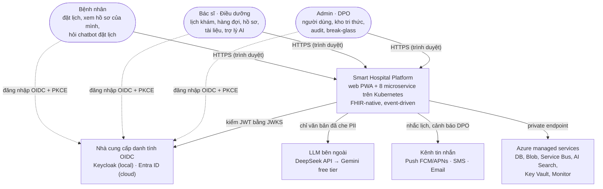

| Bên ngoài | Dữ liệu trao đổi | Kiểm soát |
|---|---|---|
| IdP | Token OIDC; không có dữ liệu lâm sàng | PKCE, token ≤ 15 phút, nhân viên bắt buộc MFA (`amr` có `mfa`) |
| LLM | Câu hỏi/ngữ cảnh **đã redact PII** | Chỉ service `ai` được egress; mọi lời gọi qua bộ redact (ADR-0013) |
| Kênh tin nhắn | Nội dung nhắc lịch tối thiểu, SĐT/email | Chỉ service `notification` được egress; nội dung không chứa chẩn đoán |
| Azure managed | Toàn bộ dữ liệu lưu trữ | Private endpoint, mã hóa at-rest, Workload Identity (không key) |

## 2. C4 mức 2 — Container

Các đơn vị triển khai độc lập (container) và kho dữ liệu của từng cái. Mỗi service **sở hữu** kho riêng; không service nào đọc DB của service khác.

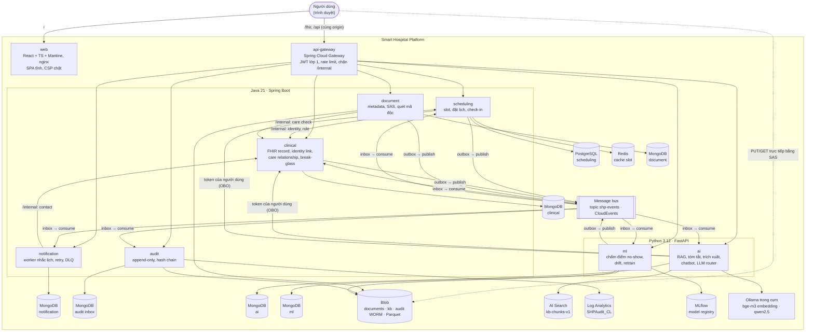

| Container | Công nghệ | Giao tiếp vào | Giao tiếp ra | Dữ liệu sở hữu |
|---|---|---|---|---|
| web | React, Vite, nginx | HTTPS `/` | — (trình duyệt gọi gateway) | — |
| api-gateway | Spring Cloud Gateway (WebFlux) | HTTPS `/fhir`, `/api` | REST tới service | — |
| scheduling | Java | REST, event E6, E7 | REST clinical, event E1–E5 | Schedule, Slot, Appointment |
| clinical | Java | REST, `/internal`, event E1/E4/E5 | event E6, E7 | Patient, Practitioner, Encounter, Observation, Condition… |
| document | Java | REST, `/internal` | Blob, event E8, E9 | DocumentReference + file |
| notification | Java worker | REST (tùy chọn nhận tin), event | Push/SMS/Email | reminder, delivery attempt |
| audit | Java worker | event E11 | Blob WORM, Log Analytics | AuditEvent |
| ai | Python | REST, event E8 | LLM ngoài, Ollama, AI Search, clinical (OBO) | kb, hội thoại, extraction job |
| ml | Python | REST, event E1/E5 | event E10, MLflow | feature state, prediction log, model |

## 3. Góc nhìn triển khai trên Azure

Một môi trường cloud (`uat` hoặc `prod`) = **một stack Terraform** (`shp-infra/envs/<env>`), một resource group, một cluster AKS. Hai môi trường
dùng subscription/identity riêng (NFR-D4). Tài nguyên thường trực chỉ có stack `bootstrap`.

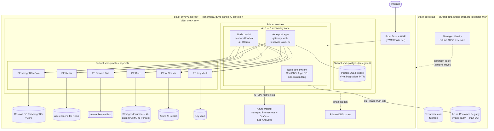

**Bên trong cluster** (repo `shp-gitops`): Argo CD tạo add-on trước (sync wave `-3`), rồi baseline, rồi service.

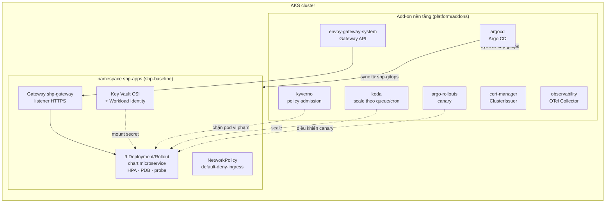

| Policy Kyverno | Mục đích |
|---|---|
| `shp-restrict-registry` | Chỉ cho image từ ACR của dự án |
| `shp-verify-signature` | Image phải có chữ ký cosign keyless từ pipeline CI (NFR-SEC6) |
| `shp-disallow-latest` | Cấm tag `latest`, buộc tag/digest cố định |
| `shp-require-resources-probes` | Bắt buộc requests/limits và readiness/liveness probe |

## 4. Vùng tin cậy và luồng mạng

Mỗi mũi tên qua ranh giới vùng đều có một điểm kiểm soát. Mặc định **chặn**; chỉ mở đúng luồng cần.

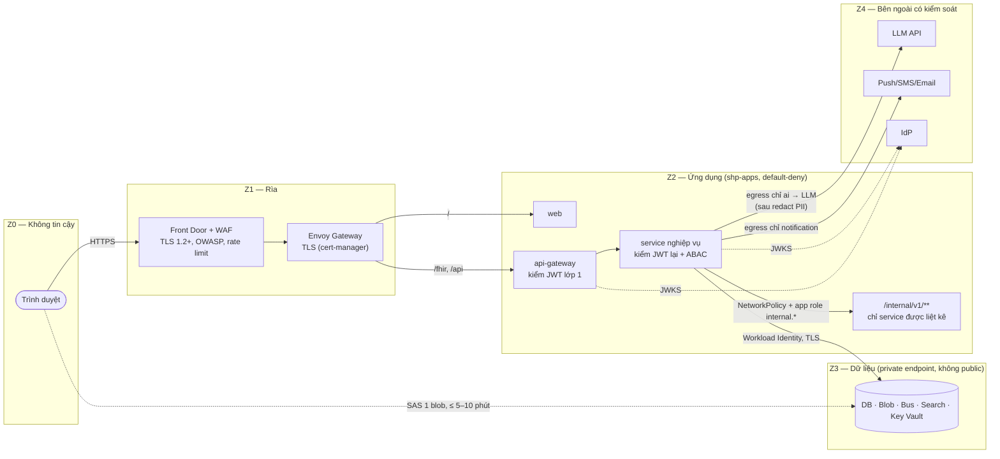

| Ranh giới | Kiểm soát | Nếu bị vượt qua |
|---|---|---|
| Z0 → Z1 | WAF, TLS, giới hạn tốc độ | Request bị chặn ở rìa, không vào cụm |
| Z1 → Z2 | Chỉ route `/`, `/fhir`, `/api`; **không có route `/internal`** | 404 ở gateway |
| Gateway → service | Service **không tin** header do gateway thêm; tự kiểm token | Token giả/hết hạn → 401 ngay tại service |
| Service → service | NetworkPolicy theo nhãn + token workload với `aud` = service đích | Bị chặn ở tầng mạng **và** ứng dụng |
| Z2 → Z3 | Private endpoint, tắt public network access, tắt shared key Blob | DB/Blob không truy cập được từ Internet |
| Z2 → Z4 | NetworkPolicy egress chỉ mở cho `ai` và `notification` (uat/prod) | Service khác không gọi ra Internet được |
| Trình duyệt → Blob | User delegation SAS: 1 blob, 1 quyền, hết hạn 5 phút (đọc) / 10 phút (ghi) | Link lộ chỉ dùng được trong thời gian ngắn, mỗi lần cấp có audit |

## 5. Danh tính, xác thực và phân quyền

### 5.1 Đăng nhập và gọi API

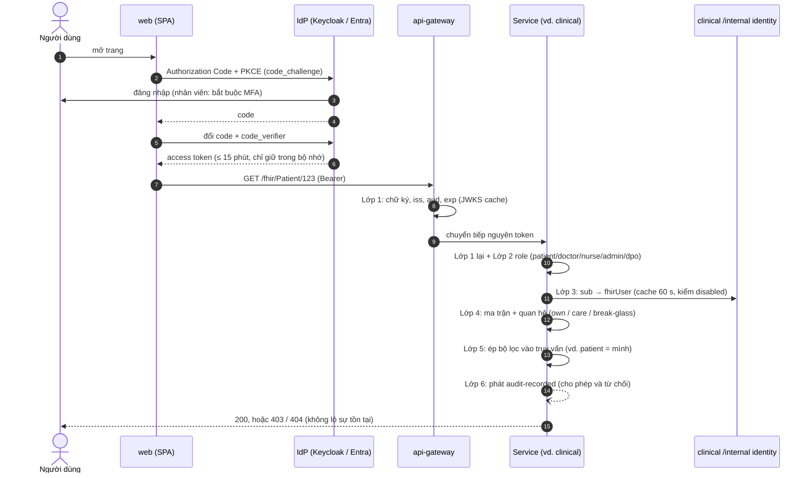

### 5.2 Các lớp kiểm soát và nơi thực thi

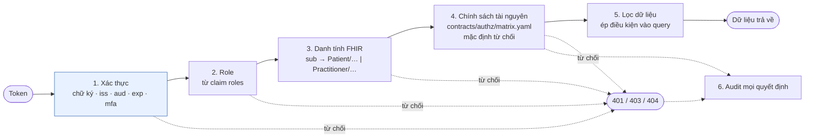

Lớp 1 chạy ở **cả** gateway và service; lớp 2–6 chỉ ở service sở hữu dữ liệu (thư viện `shp-web` + `shp-authz`). Ma trận được nhúng vào jar lúc
build và sinh test tự động; endpoint thiếu `@RequireShpAuthz` làm test đỏ.

### 5.3 Gọi thay mặt người dùng và gọi nội bộ

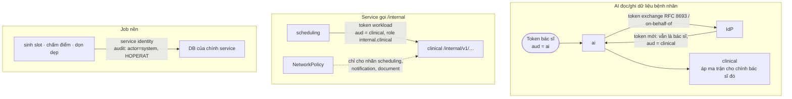

AI **không có quyền riêng** để đọc hồ sơ: nếu bác sĩ không được xem bệnh nhân thì AI gọi thay bác sĩ cũng bị từ chối. Mọi thao tác ghi
từ AI (tạo `Observation` từ trích xuất, đặt lịch qua chatbot) chỉ chạy **sau khi người dùng xác nhận**.

> ADR-0017 (đang review) đề xuất dùng Keycloak cho mọi môi trường thay cho Entra ID ở cloud. Nếu được chấp nhận, chỉ ô IdP trong các sơ
> đồ trên thay đổi; luồng PKCE, token exchange và các lớp kiểm soát giữ nguyên.

## 6. Bảo vệ dữ liệu sức khỏe

### 6.1 Phân loại dữ liệu và nơi lưu

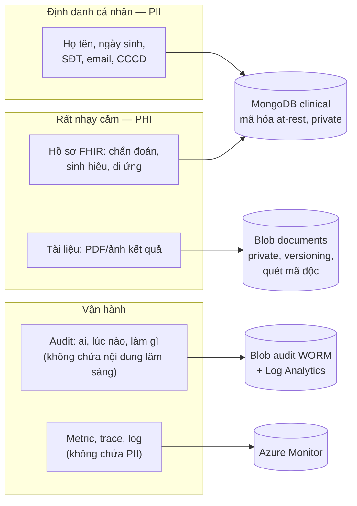

| Quy tắc | Thực thi ở đâu |
|---|---|
| Chỉ `clinical` lưu SĐT/email; chỉ một endpoint nội bộ trả thông tin liên hệ, mỗi lần gọi đều audit | `clinical` `/internal/v1/patients/{id}/contact` |
| Event không chứa PII/PHI thô (chỉ ID, nhóm tuổi `ageBand`, trạng thái) | JSON Schema trong `contracts/events`, kiểm lúc publish |
| Log/trace không chứa PII; IP trong audit được che | `shp-service-defaults`, `AuditRecordBuilder` |
| Mọi văn bản gửi LLM ngoài cụm phải qua redact PII | LLM router của `ai` (PY-06); không có cờ tắt cho DeepSeek/Gemini |
| Bệnh nhân chỉ thấy lần khám đã kết thúc và tài liệu đã phát hành | Lớp 4–5 phân quyền |
| Mã hóa: TLS khi truyền, at-rest cho mọi kho; secret chỉ ở Key Vault | Terraform + Key Vault CSI |

### 6.2 Audit chống sửa/xóa

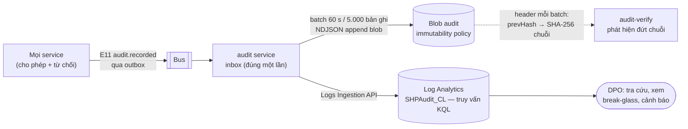

Không ai (kể cả Owner) xóa được blob audit trong thời gian khóa ở prod. Log Analytics phục vụ truy vấn nhanh; Blob WORM là bản gốc để đối chiếu.

## 7. Độ tin cậy của luồng event

Ghi dữ liệu và phát event **không bao giờ lệch nhau**: event nằm trong cùng transaction với dữ liệu, và mỗi consumer xử lý đúng một lần.

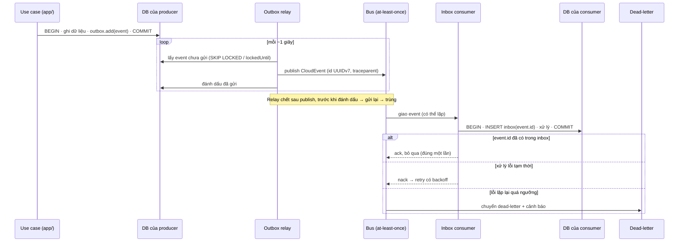

## 8. CI/CD và GitOps

### 8.1 Bốn repository

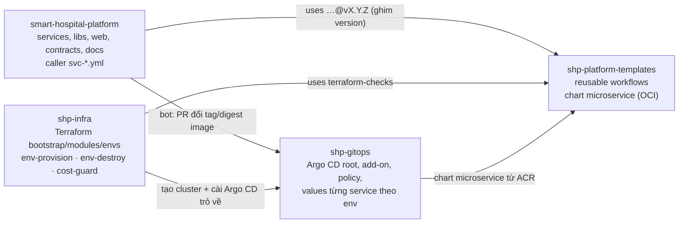

### 8.2 Pipeline của một service

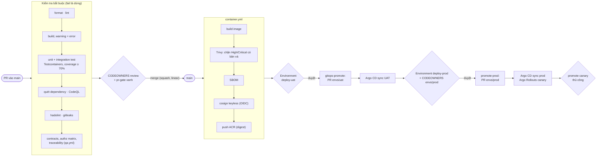

Không có `kubectl apply` hay `helm install` tay: Argo CD là đường duy nhất thay đổi cluster. **Rollback = revert commit** trong `shp-gitops`.
GitHub đăng nhập Azure bằng OIDC federated credential, mỗi môi trường một identity, không lưu client secret.

### 8.3 Cổng phê duyệt

| Hành động | Cơ chế | Người duyệt |
|---|---|---|
| Merge code | PR + CI xanh + CODEOWNERS | Service owner hoặc PM |
| Deploy UAT | Environment `deploy-uat` + PR GitOps | DevOps |
| Promote prod | Environment `deploy-prod` + PR GitOps + promote canary | DevOps + Architect |
| Dựng / hủy môi trường | `env-provision` / `env-destroy` + Environment `infra-<env>` | DevOps |

## 9. Môi trường và vòng đời

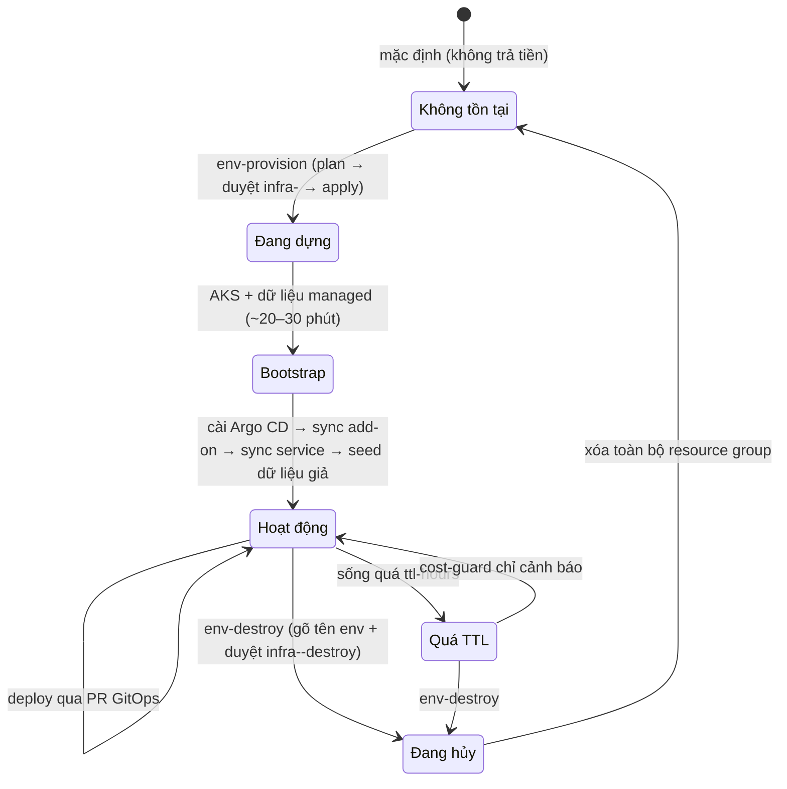

| | local | uat | prod |
|---|---|---|---|
| Chạy ở | kind trên máy dev | AKS ephemeral | AKS ephemeral |
| Mục đích | viết code, test với đủ phụ thuộc | tích hợp, nghiệm thu, load/failure test | chỉ demo/bảo vệ |
| IdP | Keycloak | Entra ID | Entra ID |
| Bus | RabbitMQ | Service Bus | Service Bus |
| Blob | Azurite | Azure Storage | Azure Storage (GZRS, WORM khóa) |
| Search | OpenSearch (profile `full`) | AI Search | AI Search |
| Policy | NetworkPolicy tắt | bật | bật |
| Ai dựng | dev (`make -C dev …`) | DevOps, sau duyệt | DevOps, sau duyệt |

**Cụm local** (`dev/`) dùng **cùng chart `microservice`** với cloud:

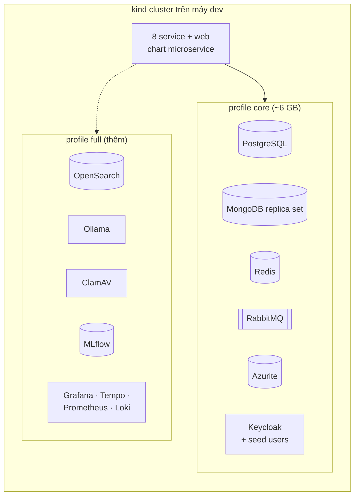

## 10. Quan sát (observability)

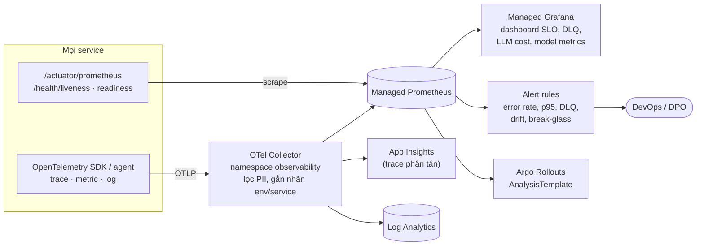

`traceparent` được đưa vào mọi CloudEvent, nên một trace đi xuyên REST và event (vd. đặt lịch → nhắc lịch → chấm điểm no-show). Local thay
Azure Monitor bằng Grafana + Tempo + Prometheus + Loki (profile `full`).

## 11. AI và ML

### 11.1 LLM router với fallback

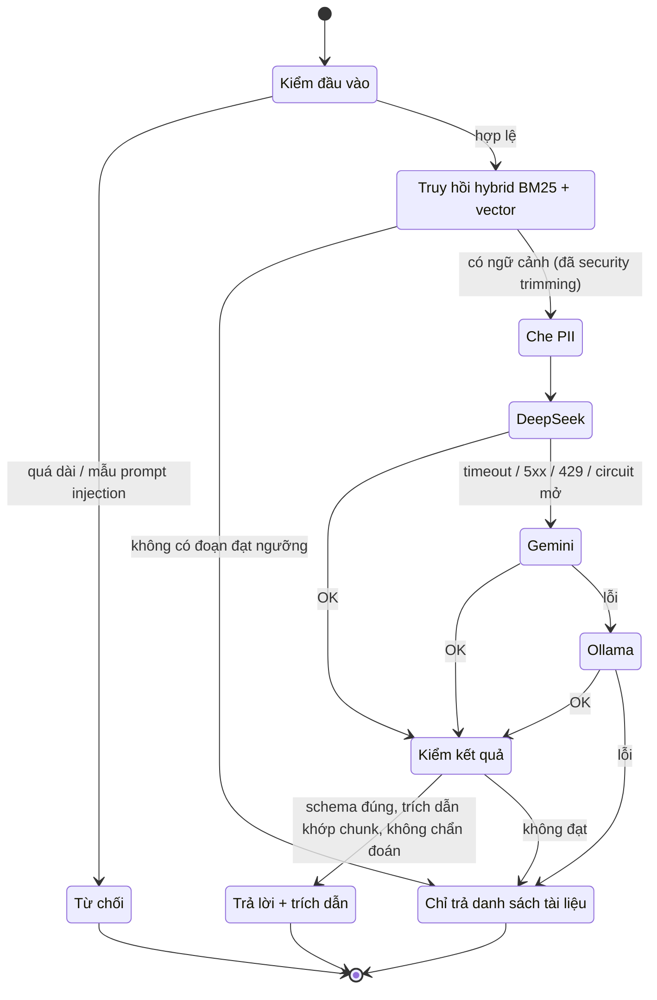

Mỗi lần gọi ghi audit `ai-query` (model, token, chi phí, mức fallback — **không** ghi nội dung câu hỏi). Ngân sách token theo ngày và circuit
breaker theo từng model nằm trong router dùng chung (PY-08, PY-09).

### 11.2 MLOps cho mô hình no-show

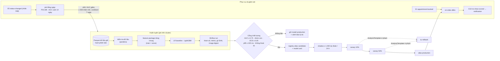

## 12. Ánh xạ sơ đồ → quyết định

| Sơ đồ | Quyết định / tài liệu gốc |
|---|---|
| §1, §2 C4 | [ADR-0001](adr/0001-microservice-boundaries.md), [ADR-0008](adr/0008-polyglot-persistence.md), [ADR-0014](adr/0014-database-per-service-review.md), [ADR-0015](adr/0015-java-for-all-services.md), [ADR-0016](adr/0016-frontend-web-app.md) |
| §3 Triển khai | [ADR-0004](adr/0004-azure-first-portable.md), [ADR-0011](adr/0011-two-environments-local-kubernetes.md); repo `shp-infra`, `shp-gitops` |
| §4 Mạng | ADR-0004 (NetworkPolicy, Kyverno, private endpoint); [overview §1](overview.md#1-sơ-đồ-kiến-trúc-tổng-thể) |
| §5 Danh tính | [15-authorization.md](detailed-design/15-authorization.md), [07-api-conventions.md](detailed-design/07-api-conventions.md) |
| §6 Dữ liệu | [05-storage-audit-blob.md](detailed-design/05-storage-audit-blob.md), [ADR-0013](adr/0013-llm-deepseek-gemini-local-embedding.md) |
| §7 Event | [13-events.md](detailed-design/13-events.md), [ADR-0005](adr/0005-booking-consistency.md) |
| §8 CI/CD | [ADR-0009](adr/0009-cicd-ephemeral-environments.md), [ADR-0010](adr/0010-repository-strategy.md) |
| §9 Môi trường | ADR-0009, ADR-0011, [dev/README.md](../../dev/README.md) |
| §10 Quan sát | ADR-0004 (Observability) |
| §11 AI/ML | [ADR-0006](adr/0006-llm-router-fallback.md), ADR-0013, [ADR-0007](adr/0007-no-show-ml-mlops.md), [06-data-ai.md](detailed-design/06-data-ai.md), [16-mlops.md](detailed-design/16-mlops.md) |

Khi thay đổi kiến trúc: sửa ADR trước, rồi cập nhật sơ đồ tương ứng ở đây và trong [overview.md](overview.md) trong cùng PR.
