# Detailed architecture diagrams — Smart Hospital Platform

> Task: ARC-04. Adds the **views** that [overview.md](overview.md) does not draw: C4 Context/Container, deployment on Azure,
> network trust zones, identity and authorization, data protection, CI/CD and GitOps, environments, observability, AI/ML.
>
> - Detailed business flows (booking, reminders, visit, documents, RAG, break-glass): [14-sequences.md](detailed-design/14-sequences.md).
> - Events: [13-events.md](detailed-design/13-events.md) · Authorization: [15-authorization.md](detailed-design/15-authorization.md) · MLOps: [16-mlops.md](detailed-design/16-mlops.md).
> - Every diagram uses Mermaid and renders directly on GitHub. The system only processes **synthetic patient data**, but the security design is as for real data.

Table of contents:
[1. C4 — Context](#1-c4-level-1--system-context) ·
[2. C4 — Container](#2-c4-level-2--container) ·
[3. Deployment on Azure](#3-deployment-view-on-azure) ·
[4. Network trust zones](#4-trust-zones-and-network-flow) ·
[5. Identity and authorization](#5-identity-authentication-and-authorization) ·
[6. Data protection](#6-protecting-health-data) ·
[7. Event reliability](#7-reliability-of-the-event-flow) ·
[8. CI/CD and GitOps](#8-cicd-and-gitops) ·
[9. Environments](#9-environments-and-lifecycle) ·
[10. Observability](#10-observability) ·
[11. AI and ML](#11-ai-and-ml) ·
[12. Diagram → decision mapping](#12-diagram--decision-mapping)

---

## 1. C4 level 1 — System Context

Who uses the system, and what the system depends on externally.

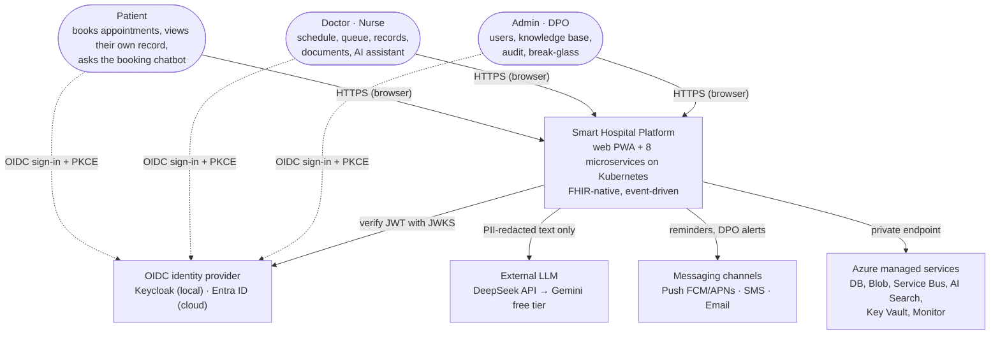

| External party | Data exchanged | Control |
|---|---|---|
| IdP | OIDC token; no clinical data | PKCE, token ≤ 15 minutes, staff must use MFA (`amr` contains `mfa`) |
| LLM | Question/context **with PII redacted** | Only the `ai` service has egress; every call goes through the redactor (ADR-0013) |
| Messaging channels | Minimal reminder content, phone number/email | Only the `notification` service has egress; content contains no diagnosis |
| Azure managed | All stored data | Private endpoint, encryption at rest, Workload Identity (no keys) |

## 2. C4 level 2 — Container

The independently deployable units (containers) and each one's data store. Each service **owns** its own store; no service reads another service's DB.

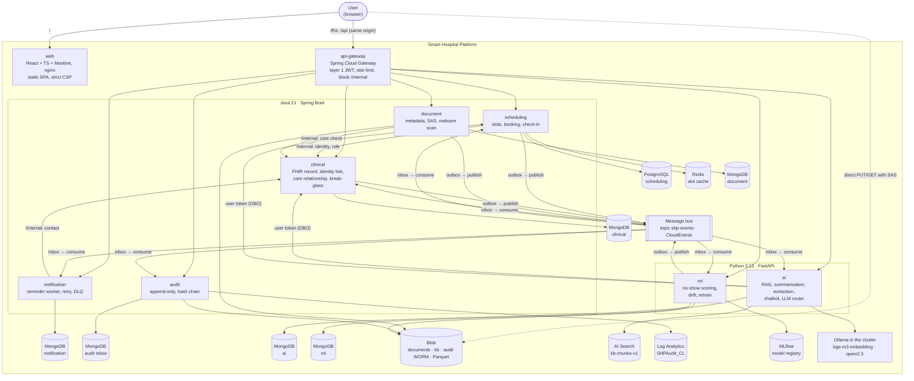

| Container | Technology | Inbound communication | Outbound communication | Data owned |
|---|---|---|---|---|
| web | React, Vite, nginx | HTTPS `/` | — (the browser calls the gateway) | — |
| api-gateway | Spring Cloud Gateway (WebFlux) | HTTPS `/fhir`, `/api` | REST to services | — |
| scheduling | Java | REST, events E6, E7 | REST clinical, events E1–E5 | Schedule, Slot, Appointment |
| clinical | Java | REST, `/internal`, events E1/E4/E5 | events E6, E7 | Patient, Practitioner, Encounter, Observation, Condition… |
| document | Java | REST, `/internal` | Blob, events E8, E9 | DocumentReference + file |
| notification | Java worker | REST (optional message intake), events | Push/SMS/Email | reminder, delivery attempt |
| audit | Java worker | event E11 | Blob WORM, Log Analytics | AuditEvent |
| ai | Python | REST, event E8 | external LLM, Ollama, AI Search, clinical (OBO) | kb, conversations, extraction job |
| ml | Python | REST, events E1/E5 | event E10, MLflow | feature state, prediction log, model |

## 3. Deployment view on Azure

One cloud environment (`uat` or `prod`) = **one Terraform stack** (`shp-infra/envs/<env>`), one resource group, one AKS cluster. The two environments
use separate subscriptions/identities (NFR-D4). The only always-on resources are the `bootstrap` stack.

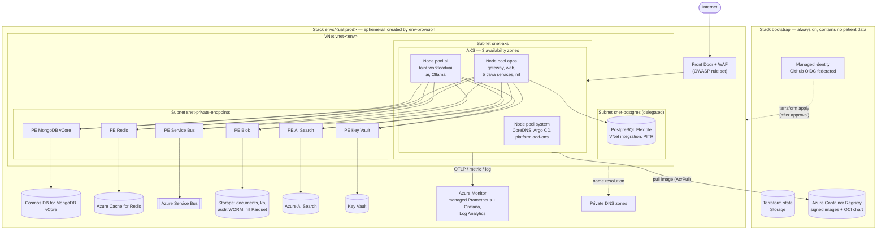

**Inside the cluster** (repo `shp-gitops`): Argo CD creates the add-ons first (sync wave `-3`), then the baseline, then the services.

| Kyverno policy | Purpose |
|---|---|
| `shp-restrict-registry` | Allow images only from the project's ACR |
| `shp-verify-signature` | Images must have a cosign keyless signature from the CI pipeline (NFR-SEC6) |
| `shp-disallow-latest` | Forbid the `latest` tag, require a fixed tag/digest |
| `shp-require-resources-probes` | Require requests/limits and readiness/liveness probes |

## 4. Trust zones and network flow

Every arrow that crosses a zone boundary has a control point. The default is **deny**; only the flows that are needed are opened.

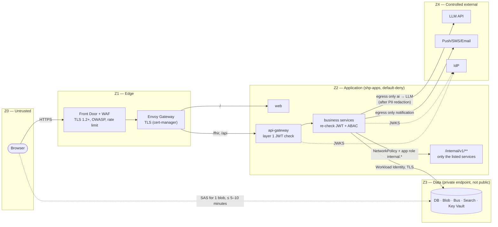

| Boundary | Control | If it is crossed |
|---|---|---|
| Z0 → Z1 | WAF, TLS, rate limiting | Request is blocked at the edge, never enters the cluster |
| Z1 → Z2 | Only routes `/`, `/fhir`, `/api`; **there is no `/internal` route** | 404 at the gateway |
| Gateway → service | Services **do not trust** headers added by the gateway; they verify the token themselves | Forged/expired token → 401 right at the service |
| Service → service | Label-based NetworkPolicy + workload token with `aud` = target service | Blocked at the network layer **and** the application layer |
| Z2 → Z3 | Private endpoint, public network access disabled, Blob shared key disabled | DB/Blob cannot be reached from the Internet |
| Z2 → Z4 | Egress NetworkPolicy opened only for `ai` and `notification` (uat/prod) | Other services cannot call out to the Internet |
| Browser → Blob | User delegation SAS: 1 blob, 1 permission, expires in 5 minutes (read) / 10 minutes (write) | A leaked link works only for a short time, and every issuance is audited |

## 5. Identity, authentication and authorization

### 5.1 Sign-in and API calls

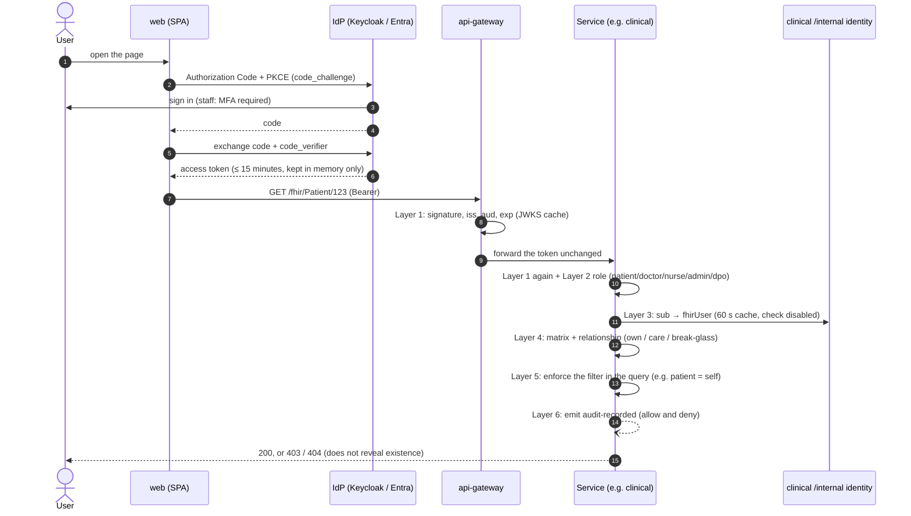

### 5.2 Control layers and where they are enforced

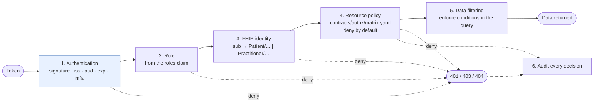

Layer 1 runs at **both** the gateway and the service; layers 2–6 run only in the service that owns the data (the `shp-web` + `shp-authz` libraries). The matrix is embedded in the jar at
build time and used to generate tests automatically; an endpoint missing `@RequireShpAuthz` makes the test fail.

### 5.3 On-behalf-of calls and internal calls

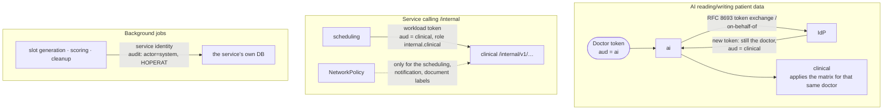

AI **has no permissions of its own** to read records: if a doctor is not allowed to view a patient, AI calling on the doctor's behalf is denied as well. Every write
from AI (creating an `Observation` from extraction, booking via the chatbot) runs **only after the user confirms**.

> ADR-0017 (under review) proposes using Keycloak for all environments instead of Entra ID in the cloud. If accepted, only the IdP box in the diagrams
> above changes; the PKCE flow, token exchange and control layers stay the same.

## 6. Protecting health data

### 6.1 Data classification and where it is stored

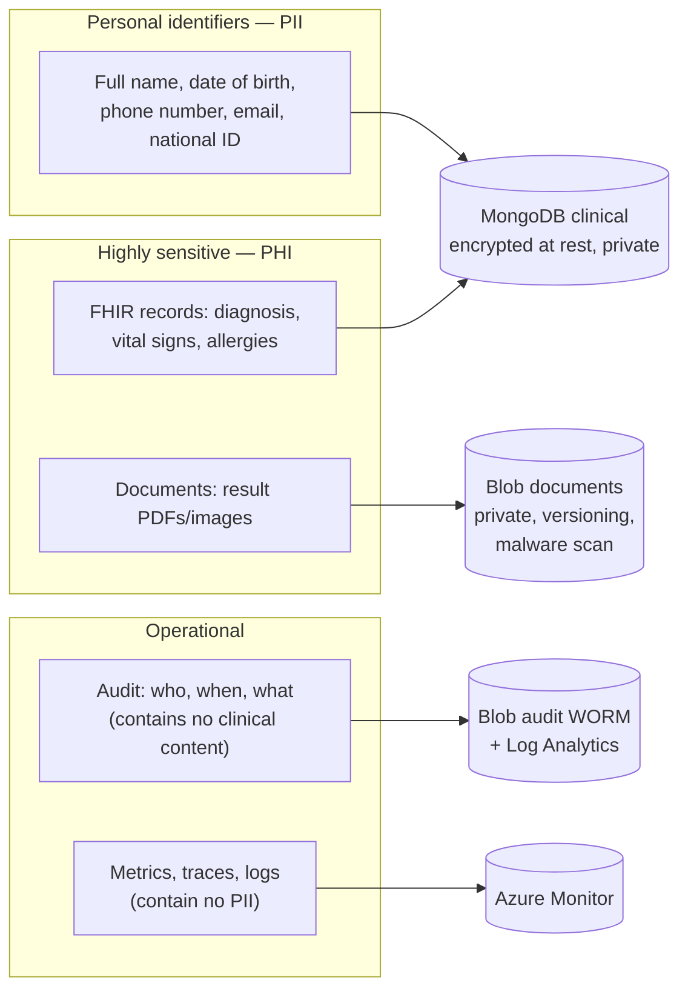

| Rule | Where it is enforced |
|---|---|
| Only `clinical` stores phone numbers/email; a single internal endpoint returns contact details, and every call is audited | `clinical` `/internal/v1/patients/{id}/contact` |
| Events contain no raw PII/PHI (only IDs, `ageBand`, status) | JSON Schema in `contracts/events`, checked at publish time |
| Logs/traces contain no PII; IP addresses in the audit are masked | `shp-service-defaults`, `AuditRecordBuilder` |
| All text sent to an LLM outside the cluster must go through PII redaction | The `ai` LLM router (PY-06); there is no off switch for DeepSeek/Gemini |
| Patients only see finished visits and released documents | Authorization layers 4–5 |
| Encryption: TLS in transit, at rest for every store; secrets only in Key Vault | Terraform + Key Vault CSI |

### 6.2 Tamper-proof audit

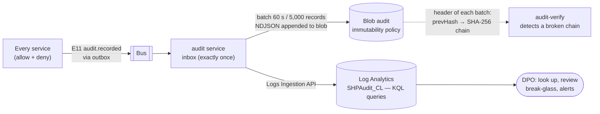

No one (not even the Owner) can delete audit blobs during the retention period in prod. Log Analytics serves fast queries; Blob WORM is the original for cross-checking.

## 7. Reliability of the event flow

Writing data and publishing the event **never diverge**: the event is in the same transaction as the data, and every consumer processes exactly once.

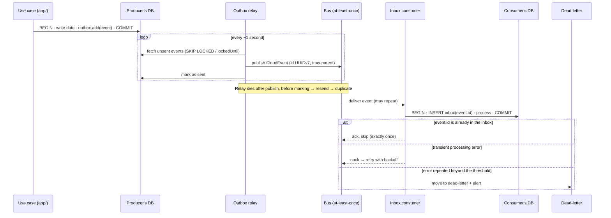

## 8. CI/CD and GitOps

### 8.1 Four repositories

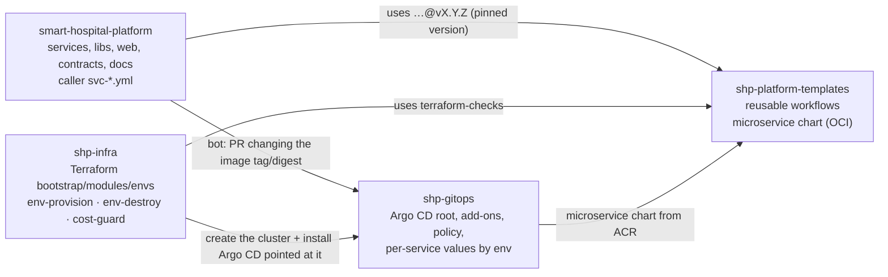

### 8.2 Pipeline of a service

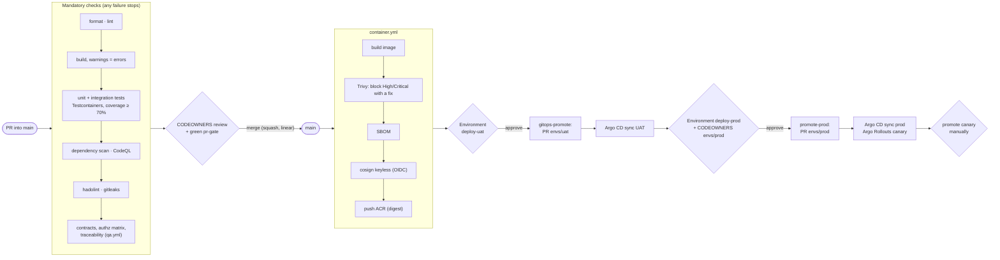

There is no manual `kubectl apply` or `helm install`: Argo CD is the only path that changes the cluster. **Rollback = revert the commit** in `shp-gitops`.
GitHub signs in to Azure with an OIDC federated credential, one identity per environment, with no client secret stored.

### 8.3 Approval gates

| Action | Mechanism | Approver |
|---|---|---|
| Merge code | PR + green CI + CODEOWNERS | Service owner or PM |
| Deploy UAT | Environment `deploy-uat` + GitOps PR | DevOps |
| Promote prod | Environment `deploy-prod` + GitOps PR + promote canary | DevOps + Architect |
| Create / destroy an environment | `env-provision` / `env-destroy` + Environment `infra-<env>` | DevOps |

## 9. Environments and lifecycle

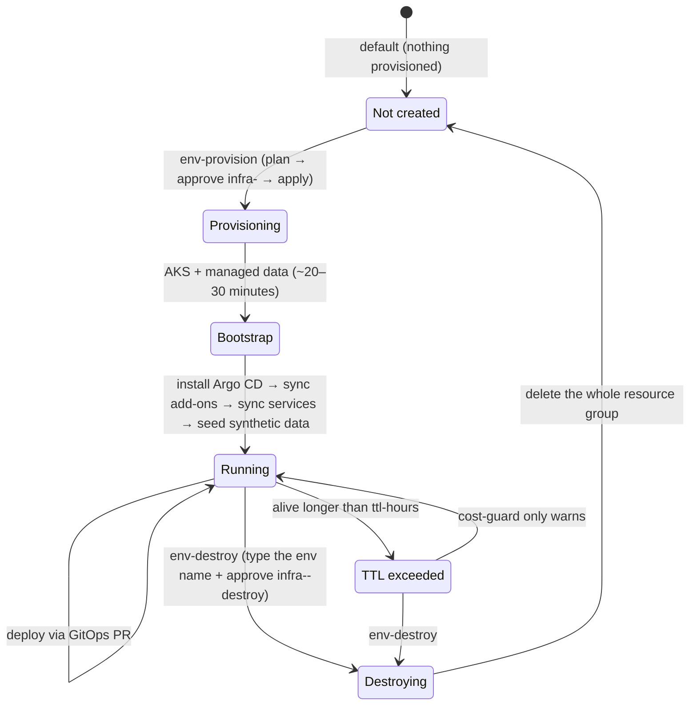

| | local | uat | prod |
|---|---|---|---|
| Runs on | kind on the dev machine | Ephemeral AKS | Ephemeral AKS |
| Purpose | writing code, testing with all dependencies | integration, acceptance, load/failure testing | demo/protection only |
| IdP | Keycloak | Entra ID | Entra ID |
| Bus | RabbitMQ | Service Bus | Service Bus |
| Blob | Azurite | Azure Storage | Azure Storage (GZRS, locked WORM) |
| Search | OpenSearch (profile `full`) | AI Search | AI Search |
| Policy | NetworkPolicy disabled | enabled | enabled |
| Provisioned by | dev (`make -C dev …`) | DevOps, after approval | DevOps, after approval |

The **local cluster** (`dev/`) uses the **same `microservice` chart** as the cloud:

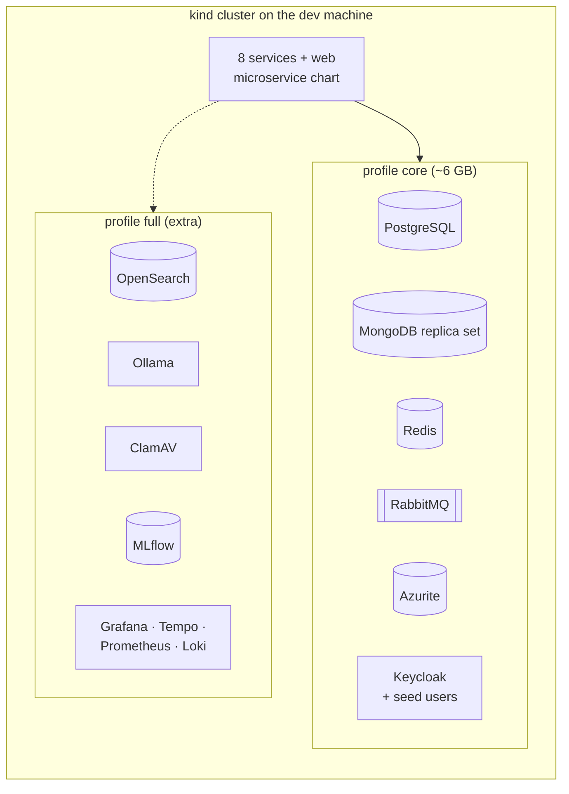

## 10. Observability

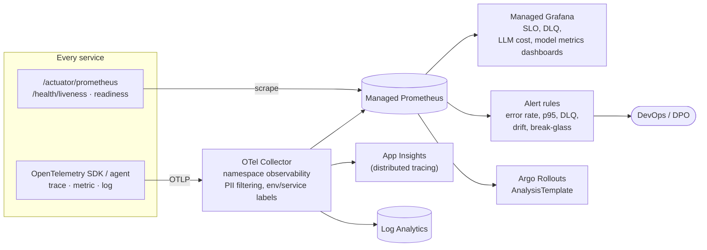

`traceparent` is included in every CloudEvent, so a trace crosses REST and events (e.g. booking → reminder → no-show scoring). Locally, Azure Monitor is replaced by
Grafana + Tempo + Prometheus + Loki (profile `full`).

## 11. AI and ML

### 11.1 LLM router with fallback

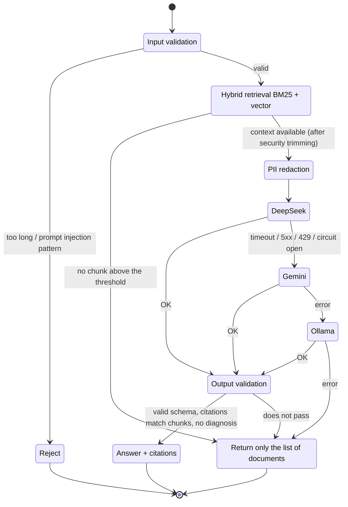

Every call writes an `ai-query` audit record (model, tokens, cost, fallback level — **not** the question content). The daily token budget and the per-model circuit
breaker live in the shared router (PY-08, PY-09).

### 11.2 MLOps for the no-show model

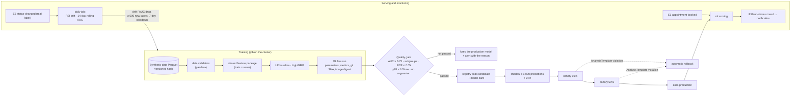

## 12. Diagram → decision mapping

| Diagram | Decision / source document |
|---|---|
| §1, §2 C4 | [ADR-0001](adr/0001-microservice-boundaries.md), [ADR-0008](adr/0008-polyglot-persistence.md), [ADR-0014](adr/0014-database-per-service-review.md), [ADR-0015](adr/0015-java-for-all-services.md), [ADR-0016](adr/0016-frontend-web-app.md) |
| §3 Deployment | [ADR-0004](adr/0004-azure-first-portable.md), [ADR-0011](adr/0011-two-environments-local-kubernetes.md); repos `shp-infra`, `shp-gitops` |
| §4 Network | ADR-0004 (NetworkPolicy, Kyverno, private endpoint); [overview §1](overview.md#1-overall-architecture-diagram) |
| §5 Identity | [15-authorization.md](detailed-design/15-authorization.md), [07-api-conventions.md](detailed-design/07-api-conventions.md) |
| §6 Data | [05-storage-audit-blob.md](detailed-design/05-storage-audit-blob.md), [ADR-0013](adr/0013-llm-deepseek-gemini-local-embedding.md) |
| §7 Events | [13-events.md](detailed-design/13-events.md), [ADR-0005](adr/0005-booking-consistency.md) |
| §8 CI/CD | [ADR-0009](adr/0009-cicd-ephemeral-environments.md), [ADR-0010](adr/0010-repository-strategy.md) |
| §9 Environments | ADR-0009, ADR-0011, [dev/README.md](../../dev/README.md) |
| §10 Observability | ADR-0004 (Observability) |
| §11 AI/ML | [ADR-0006](adr/0006-llm-router-fallback.md), ADR-0013, [ADR-0007](adr/0007-no-show-ml-mlops.md), [06-data-ai.md](detailed-design/06-data-ai.md), [16-mlops.md](detailed-design/16-mlops.md) |

When the architecture changes: update the ADR first, then update the corresponding diagram here and in [overview.md](overview.md) in the same PR.
