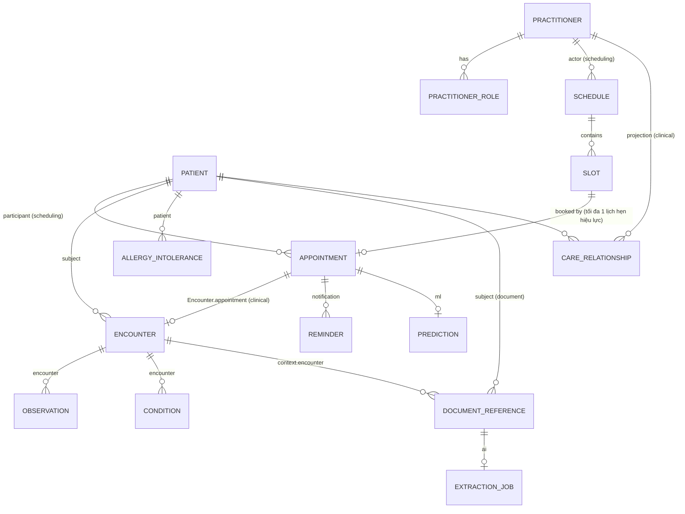
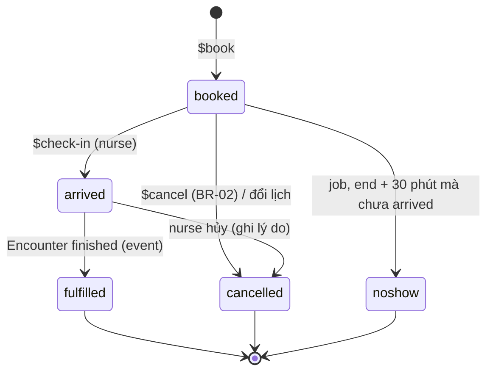

# 01 — Domain model

## 1. Bounded context và quyền sở hữu dữ liệu

Mỗi loại dữ liệu có **đúng một service sở hữu** (chỉ service đó được ghi). Service khác chỉ giữ **tham chiếu theo ID**
(`Patient/0192...`) hoặc projection chỉ đọc được cập nhật từ event.

| Context / service | Resource FHIR sở hữu | Dữ liệu nội bộ (không phải FHIR) | Kho |
|---|---|---|---|
| **clinical** | Patient, Practitioner, PractitionerRole, Encounter, Observation, Condition, AllergyIntolerance | `identity_links`, `care_relationships` (projection), `break_glass_sessions` | MongoDB `clinical` |
| **scheduling** | Schedule, Slot, Appointment | `schedule_template`, `outbox`, `idempotency_key`, `inbox` | PostgreSQL `scheduling` |
| **document** | DocumentReference | `upload_sessions`; file gốc trên Blob | MongoDB `document` + Blob |
| **notification** | — | `reminder`, `delivery_attempt`, `notification_preference`, `inbox` | PostgreSQL `notification` |
| **audit** | — (xuất được dạng FHIR AuditEvent) | Bản ghi audit | Blob WORM + Log Analytics |
| **ai** | — | `kb_documents`, `conversations`, `messages`, `feedback`, `extraction_jobs` | MongoDB `ai` + AI Search |
| **ml** | — | `attendance_stats`, `prediction` | PostgreSQL `ml` + MLflow |

## 2. Sơ đồ quan hệ

Tham chiếu xuyên service (ví dụ `Encounter.appointment` → scheduling) **không có khóa ngoại**; tính toàn vẹn được bảo đảm
bằng việc chỉ tạo tham chiếu từ ID nhận qua event hoặc API đã xác thực.

## 3. Value set dùng chung

| Value set | Mã |
|---|---|
| Chuyên khoa (`specialty`) | `internal-medicine` Nội tổng quát · `cardiology` Tim mạch · `pediatrics` Nhi · `obstetrics-gynecology` Sản phụ khoa · `dermatology` Da liễu · `ent` Tai mũi họng · `ophthalmology` Mắt · `orthopedics` Chấn thương chỉnh hình · `neurology` Thần kinh · `gastroenterology` Tiêu hóa · `endocrinology` Nội tiết · `general-surgery` Ngoại tổng quát |
| Lý do hủy lịch (`cancel-reason`) | `patient-request` · `practitioner-unavailable` · `duplicate` · `rescheduled` · `system-noshow-cleanup` · `other` |
| Kênh đặt lịch (`booking-channel`) | `web` · `chatbot` · `staff` |
| Sinh hiệu (LOINC) | `8867-4` mạch (/min) · `85354-9` huyết áp (panel: `8480-6` tâm thu, `8462-4` tâm trương, mm[Hg]) · `8310-5` nhiệt độ (Cel) · `9279-1` nhịp thở (/min) · `59408-5` SpO2 (%) · `29463-7` cân nặng (kg) · `8302-2` chiều cao (cm) · `39156-5` BMI (kg/m2) |
| Loại tài liệu (LOINC) | `11502-2` kết quả xét nghiệm · `18748-4` kết quả chẩn đoán hình ảnh · `57833-6` đơn thuốc · `57133-1` giấy chuyển viện · `34133-9` tóm tắt đợt điều trị · `51851-4` giấy tờ hành chính |
| Chẩn đoán | ICD-10 (`http://hl7.org/fhir/sid/icd-10`) |

## 4. Profile từng resource

Ký hiệu: **1..1** bắt buộc · **0..1** tùy chọn · **0..\*** nhiều. Trường không liệt kê thì **không dùng** và bị từ chối
khi ghi (giảm bề mặt dữ liệu, tối thiểu hóa dữ liệu cá nhân).

### 4.1 Patient (clinical)

| Trường | Card. | Ràng buộc / ghi chú |
|---|---|---|
| `identifier[mrn]` | 1..1 | system `urn:shp:mrn`, value `BN-YYYY-NNNNNN`, server sinh, không đổi |
| `active` | 1..1 | `false` khi gộp hồ sơ trùng |
| `name` | 1..1 | `use=official`, `family`, `given[]`, `text` (họ tên đầy đủ); độ dài 2–100 |
| `telecom[phone]` | 1..1 | `system=phone`, E.164 (`+84...`); dùng để nhắc lịch và chống trùng |
| `telecom[email]` | 0..1 | `system=email` |
| `identifier[cccd]` | 0..1 | system `urn:shp:cccd`; số căn cước công dân 12 chữ số, **không bắt buộc**, chỉ điều dưỡng ghi khi bệnh nhân đến khám và đồng ý; lưu mã hóa, chỉ trả bản che (4 số cuối) |
| `gender` | 1..1 | `male` · `female` · `other` · `unknown` |
| `birthDate` | 1..1 | không ở tương lai, tuổi ≤ 120 |
| `address` | 0..1 | `text`, `city`, `district` (không lưu số nhà chi tiết) |
| `contact` | 0..1 | người liên hệ khẩn cấp: `name.text`, `telecom[phone]`, `relationship.text` |
| `communication.language` | 0..1 | `vi` (mặc định) hoặc `en`; quyết định ngôn ngữ thông báo |
| `link` | 0..\* | `type=replaced-by` khi gộp hồ sơ trùng (UC-01 luồng phụ) |

Một tài khoản có một hồ sơ "bản thân" (`identity_links`) và có thể quản lý thêm hồ sơ khác qua `profile_links` (con dưới 16 tuổi, người lớn ủy quyền; ADR-0018). Quan hệ này không phải resource FHIR; khi cần trao đổi có thể ánh xạ sang `RelatedPerson`.

Không lưu nghề nghiệp, dân tộc, CMND 9 số (không cần cho phạm vi; tối thiểu hóa dữ liệu nhạy cảm). Số CCCD chỉ lưu khi bệnh nhân đồng ý và được bổ sung khi đến khám (SRS UC `supplement-national-id`).

### 4.2 Practitioner và PractitionerRole (clinical)

| Practitioner | Card. | Ghi chú |
|---|---|---|
| `identifier[staff]` | 1..1 | `urn:shp:practitioner`, `NV-NNNN` |
| `active` | 1..1 | |
| `name` | 1..1 | `text`, `prefix` (ví dụ `BS.`, `ThS.BS.`) |
| `telecom[work]` | 0..1 | email công việc |
| `gender` | 0..1 | |
| `qualification[].code.text` | 0..\* | ví dụ "Chuyên khoa I Tim mạch" |

| PractitionerRole | Card. | Ghi chú |
|---|---|---|
| `practitioner` | 1..1 | `Practitioner/{id}` |
| `active` | 1..1 | |
| `specialty` | 1..1 | value set chuyên khoa |
| `code` | 1..1 | `doctor` · `nurse` (vai trò lâm sàng; khác với role đăng nhập) |

### 4.3 Schedule (scheduling)

| Trường | Card. | Ghi chú |
|---|---|---|
| `active` | 1..1 | |
| `actor` | 1..1 | đúng một `Practitioner/{id}`, có `display` (tên bác sĩ, denormalize để hiển thị) |
| `specialty` | 1..1 | mỗi bác sĩ tối đa **một** Schedule đang hoạt động cho mỗi chuyên khoa |
| `planningHorizon` | 1..1 | `start` = hôm nay, `end` = hôm nay + 30 ngày (BR-04), cập nhật bởi job sinh slot |
| `comment` | 0..1 | |

Mẫu lịch tuần (`schedule_template`, không phải FHIR): thứ trong tuần, giờ bắt đầu/kết thúc, độ dài slot (10/15/20/30 phút),
hiệu lực từ/đến. Chi tiết trong [02-db-scheduling.md](02-db-scheduling.md).

### 4.4 Slot (scheduling)

| Trường | Card. | Ghi chú |
|---|---|---|
| `schedule` | 1..1 | `Schedule/{id}` |
| `status` | 1..1 | `free` · `busy` · `busy-unavailable` (bị chặn) |
| `start`, `end` | 1..1 | `end > start`; không chồng lấn trong cùng Schedule (ràng buộc DB) |
| `specialty` | 1..1 | sao chép từ Schedule để lọc nhanh |
| `comment` | 0..1 | lý do chặn |

### 4.5 Appointment (scheduling)

| Trường | Card. | Ghi chú |
|---|---|---|
| `status` | 1..1 | `booked` · `arrived` · `fulfilled` · `cancelled` · `noshow` (xem state machine) |
| `slot` | 1..1 | đúng một `Slot/{id}` |
| `start`, `end` | 1..1 | sao chép từ Slot |
| `specialty` | 1..1 | sao chép từ Slot |
| `participant[patient]` | 1..1 | `actor=Patient/{id}`, `status=accepted` |
| `participant[practitioner]` | 1..1 | `actor=Practitioner/{id}` (+`display`), `status=accepted` |
| `created` | 1..1 | thời điểm đặt |
| `comment` | 0..1 | ghi chú của bệnh nhân, ≤ 500 ký tự |
| `cancelationReason` | 0..1 | bắt buộc khi `status=cancelled`; value set lý do hủy |
| `extension[booking-channel]` | 1..1 | `web` · `chatbot` · `staff` |
| `extension[rescheduled-from]` | 0..1 | `Appointment/{id}` của lịch cũ khi đổi lịch |

### 4.6 Encounter (clinical)

| Trường | Card. | Ghi chú |
|---|---|---|
| `status` | 1..1 | `arrived` · `in-progress` · `finished` · `cancelled` |
| `class` | 1..1 | `AMB` (ngoại trú, `http://terminology.hl7.org/CodeSystem/v3-ActCode`) |
| `subject` | 1..1 | `Patient/{id}` |
| `participant[attender]` | 1..1 | `Practitioner/{id}`, `type=ATND` |
| `appointment` | 1..1 | `Appointment/{id}` (tạo từ event check-in) |
| `serviceType` | 1..1 | chuyên khoa |
| `period` | 1..1 | `start` lúc check-in, `end` lúc kết thúc |
| `reasonCode[].text` | 0..\* | lý do khám |
| `diagnosis[].condition` | 0..\* | `Condition/{id}` |
| `extension[clinical-note]` | 0..1 | `valueMarkdown`: bệnh sử, khám lâm sàng; chỉ sửa được khi chưa `finished` |
| `extension[addendum]` | 0..\* | complex: `author` (Practitioner), `recordedAt`, `text`; cách duy nhất để bổ sung sau khi `finished` (AC-04.2) |

### 4.7 Observation (clinical)

| Trường | Card. | Ghi chú |
|---|---|---|
| `status` | 1..1 | `final` · `amended` · `entered-in-error` |
| `category` | 1..1 | `vital-signs` hoặc `laboratory` |
| `code` | 1..1 | LOINC theo value set sinh hiệu; xét nghiệm dùng LOINC tự do |
| `subject` | 1..1 | `Patient/{id}` |
| `encounter` | 0..1 | bắt buộc với sinh hiệu |
| `effectiveDateTime` | 1..1 | |
| `performer` | 1..1 | `Practitioner/{id}` |
| `valueQuantity` | 0..1 | đơn vị UCUM theo bảng value set; có kiểm tra khoảng hợp lý (ví dụ nhiệt độ 30–45 °C) |
| `component[]` | 0..\* | chỉ cho huyết áp (tâm thu, tâm trương) |
| `interpretation` | 0..1 | `H` · `L` · `N`, server tính theo `referenceRange` |
| `referenceRange` | 0..1 | |
| `derivedFrom` | 0..1 | `DocumentReference/{id}` khi tạo từ kết quả trích xuất AI đã duyệt |

### 4.8 Condition (clinical)

| Trường | Card. | Ghi chú |
|---|---|---|
| `clinicalStatus` | 1..1 | `active` · `resolved` |
| `verificationStatus` | 1..1 | `provisional` · `confirmed` |
| `category` | 1..1 | `encounter-diagnosis` · `problem-list-item` (bệnh nền) |
| `code` | 1..1 | ICD-10 |
| `subject` | 1..1 | |
| `encounter` | 0..1 | bắt buộc với `encounter-diagnosis` |
| `recordedDate` | 1..1 | |
| `recorder` | 1..1 | `Practitioner/{id}`, phải có quan hệ điều trị |
| `note[].text` | 0..\* | |

### 4.9 AllergyIntolerance (clinical)

| Trường | Card. | Ghi chú |
|---|---|---|
| `clinicalStatus` | 1..1 | `active` · `inactive` |
| `code.text` | 1..1 | tên dị nguyên |
| `patient` | 1..1 | |
| `criticality` | 0..1 | `low` · `high` · `unable-to-assess` |
| `reaction[].manifestation[].text` | 0..\* | |
| `recordedDate`, `recorder` | 1..1 | |

### 4.10 DocumentReference (document)

| Trường | Card. | Ghi chú |
|---|---|---|
| `status` | 1..1 | `current` · `entered-in-error` |
| `docStatus` | 1..1 | `preliminary` (đang quét) · `final` |
| `type` | 1..1 | value set loại tài liệu |
| `subject` | 1..1 | `Patient/{id}` |
| `date` | 1..1 | thời điểm tải lên |
| `author` | 1..1 | `Practitioner/{id}` |
| `context.encounter` | 0..1 | `Encounter/{id}` |
| `description` | 0..1 | ≤ 200 ký tự |
| `content[0].attachment` | 1..1 | `contentType` (`application/pdf`, `image/jpeg`, `image/png`), `size` ≤ 20 MB, `hash` (SHA-1 base64 theo FHIR), `title`, `creation`; **không lưu `url`**: link tải được cấp riêng, hết hạn sau 5 phút |
| `extension[released-to-patient]` | 0..1 | complex: `releasedAt`, `releasedBy` (AC-05.3) |

## 5. State machine

### Appointment

Slot đi kèm: `free → busy` khi `booked`; `busy → free` khi `cancelled` **trước** giờ khám; các trạng thái kết thúc khác giữ `busy`.

### Encounter
`arrived` (tạo từ event check-in) → `in-progress` (bác sĩ mở) → `finished` (bác sĩ kết thúc; phát `EncounterFinished`) ;
`arrived` → `cancelled` (bệnh nhân bỏ về).

### DocumentReference (trạng thái xử lý nội bộ)
`pending-upload` → `scanning` → `available` (phát `DocumentUploaded`) | `quarantined` (có mã độc) ; `available` → `entered-in-error`.

### Extraction job (ai)
`queued` → `ocr` → `classifying` → `extracting` → `validating` → `needs-review` → `accepted` | `rejected` ;
bất kỳ bước nào lỗi → retry (tối đa 3) → `failed` (dead-letter).
