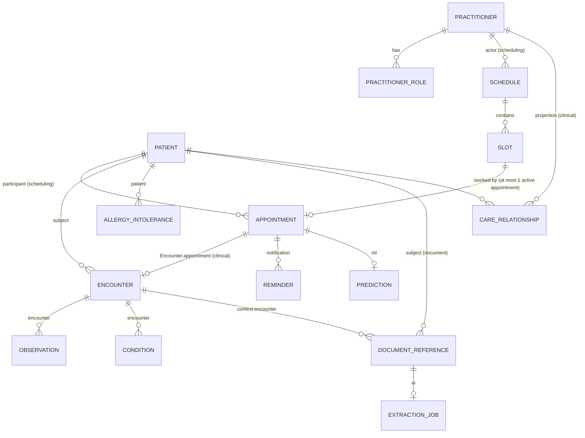
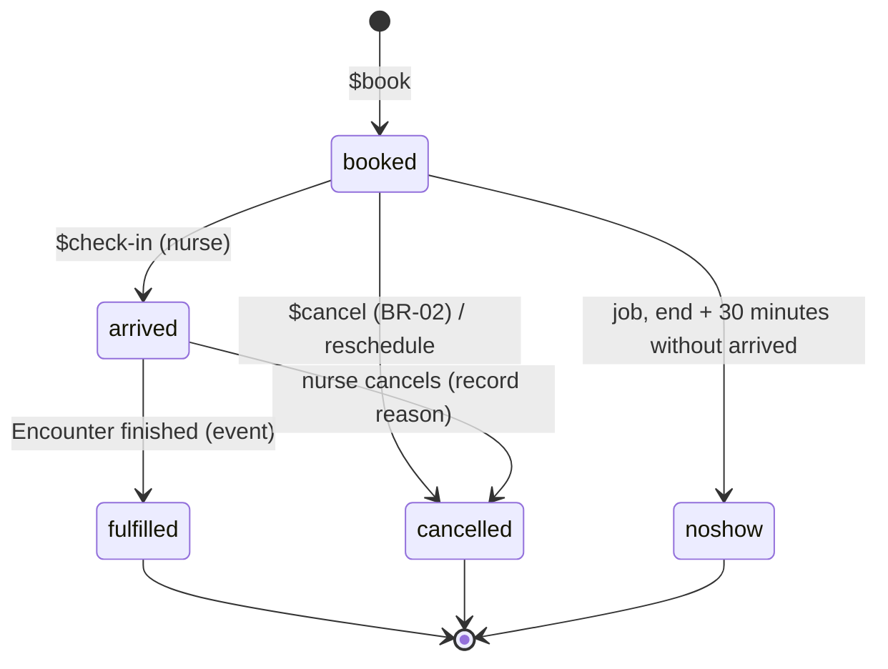

# 01 — Domain model

## 1. Bounded contexts and data ownership

Each data type has **exactly one owning service** (only that service may write). Other services keep only **ID references**
(`Patient/0192...`) or read-only projections updated from events.

| Context / service | Owned FHIR resources | Internal data (non-FHIR) | Store |
|---|---|---|---|
| **clinical** | Patient, Practitioner, PractitionerRole, Encounter, Observation, Condition, AllergyIntolerance | `identity_links`, `care_relationships` (projection), `break_glass_sessions` | MongoDB `clinical` |
| **scheduling** | Schedule, Slot, Appointment | `schedule_template`, `outbox`, `idempotency_key`, `inbox` | PostgreSQL `scheduling` |
| **document** | DocumentReference | `upload_sessions`; original files on Blob | MongoDB `document` + Blob |
| **notification** | — | `reminder`, `delivery_attempt`, `notification_preference`, `inbox` | PostgreSQL `notification` |
| **audit** | — (exportable as FHIR AuditEvent) | Audit records | Blob WORM + Log Analytics |
| **ai** | — | `kb_documents`, `conversations`, `messages`, `feedback`, `extraction_jobs` | MongoDB `ai` + AI Search |
| **ml** | — | `attendance_stats`, `prediction` | PostgreSQL `ml` + MLflow |

## 2. Relationship diagram

Cross-service references (for example `Encounter.appointment` → scheduling) **have no foreign keys**; integrity is ensured
by creating references only from IDs received through events or an authenticated API.

## 3. Shared value sets

| Value set | Codes |
|---|---|
| Specialty (`specialty`) | `internal-medicine` Internal medicine · `cardiology` Cardiology · `pediatrics` Pediatrics · `obstetrics-gynecology` Obstetrics and gynecology · `dermatology` Dermatology · `ent` Ear, nose, and throat · `ophthalmology` Ophthalmology · `orthopedics` Orthopedics · `neurology` Neurology · `gastroenterology` Gastroenterology · `endocrinology` Endocrinology · `general-surgery` General surgery |
| Cancellation reason (`cancel-reason`) | `patient-request` · `practitioner-unavailable` · `duplicate` · `rescheduled` · `system-noshow-cleanup` · `other` |
| Booking channel (`booking-channel`) | `web` · `chatbot` · `staff` |
| Clinical role (`practitioner-role`, `PractitionerRole.code`) | `doctor` Doctor · `nurse` Nurse |
| Vital signs (LOINC) | `8867-4` heart rate (/min) · `85354-9` blood pressure (panel: `8480-6` systolic, `8462-4` diastolic, mm[Hg]) · `8310-5` temperature (Cel) · `9279-1` respiratory rate (/min) · `59408-5` SpO2 (%) · `29463-7` weight (kg) · `8302-2` height (cm) · `39156-5` BMI (kg/m2) |
| Document type (LOINC) | `11502-2` laboratory test result · `18748-4` diagnostic imaging result · `57833-6` prescription · `57133-1` referral letter · `34133-9` care encounter summary · `51851-4` administrative document |
| Diagnosis | ICD-10 (`http://hl7.org/fhir/sid/icd-10`) |

ICD-10 uses a 444-code subset of common diagnoses for a general hospital (ARC-20), not the full catalogue; the machine-readable copy is `contracts/terminology/dist/icd10-subset.json`, generated by `tools/contracts/export_terminology.py` and loaded by CLN-16/CLN-18/CLN-25.

### 3.1 SHP-defined extensions

URL follows the canonical convention (`https://shp.example.org/fhir/StructureDefinition/<key>`); the machine-readable list is in `contracts/terminology/code-systems.yaml` (`extensions`).

| Key | Attached to | Value type |
|---|---|---|
| `booking-channel` | Appointment | `valueCode` (value set `booking-channel`) |
| `rescheduled-from` | Appointment | `valueReference` (`Appointment`) |
| `clinical-note` | Encounter | `valueMarkdown` |
| `addendum` | Encounter | complex: `author` (`valueReference` Practitioner), `recordedAt` (`valueDateTime`), `text` (`valueMarkdown`) |
| `released-to-patient` | DocumentReference | complex: `releasedAt` (`valueDateTime`), `releasedBy` (`valueReference` Practitioner) |

## 4. Profile per resource

Notation: **1..1** required · **0..1** optional · **0..\*** many. Fields not listed are **not used** and are rejected
on write (reduce the data surface, minimize personal data).

### 4.1 Patient (clinical)

| Field | Card. | Constraint / note |
|---|---|---|
| `identifier[mrn]` | 1..1 | system `urn:shp:mrn`, value `BN-YYYY-NNNNNN`, server-generated, immutable |
| `active` | 1..1 | `false` when merging duplicate records |
| `name` | 1..1 | `use=official`, `family`, `given[]`, `text` (full name); length 2–100 |
| `telecom[phone]` | 1..1 | `system=phone`, E.164 (`+84...`); used for reminders and deduplication |
| `telecom[email]` | 0..1 | `system=email` |
| `identifier[cccd]` | 0..1 | system `urn:shp:cccd`; 12-digit citizen identity number, **not required**, only recorded by a nurse when the patient arrives and consents; stored encrypted, returned only masked (last 4 digits) |
| `gender` | 1..1 | `male` · `female` · `other` · `unknown` |
| `birthDate` | 1..1 | not in the future, age ≤ 120 |
| `address` | 0..1 | `text`, `city`, `district` (do not store detailed street address) |
| `contact` | 0..1 | emergency contact: `name.text`, `telecom[phone]`, `relationship.text` |
| `communication.language` | 0..1 | `vi` (default) or `en`; determines notification language |
| `link` | 0..\* | `type=replaced-by` when merging duplicate records (UC-01 alternate flow) |

An account has one "self" profile (`identity_links`) and can manage additional profiles through `profile_links` (children under 16, authorized adults; ADR-0018). This relationship is not a FHIR resource; when exchange is needed it can be mapped to `RelatedPerson`.

Do not store occupation, ethnicity, or 9-digit ID card (not needed for scope; minimize sensitive data). The national ID number is stored only when the patient consents and is added at the visit (SRS UC `supplement-national-id`).

### 4.2 Practitioner and PractitionerRole (clinical)

| Practitioner | Card. | Note |
|---|---|---|
| `identifier[staff]` | 1..1 | `urn:shp:practitioner`, `NV-NNNN` |
| `active` | 1..1 | |
| `name` | 1..1 | `text`, `prefix` (for example `Dr.`, `MSc.Dr.`) |
| `telecom[work]` | 0..1 | work email |
| `gender` | 0..1 | |
| `qualification[].code.text` | 0..\* | for example "Specialist Level I, Cardiology" |

| PractitionerRole | Card. | Note |
|---|---|---|
| `practitioner` | 1..1 | `Practitioner/{id}` |
| `active` | 1..1 | |
| `specialty` | 1..1 | specialty value set |
| `code` | 1..1 | `doctor` · `nurse` (clinical role; different from the login role) |

### 4.3 Schedule (scheduling)

| Field | Card. | Note |
|---|---|---|
| `active` | 1..1 | |
| `actor` | 1..1 | exactly one `Practitioner/{id}`, with `display` (doctor name, denormalized for display) |
| `specialty` | 1..1 | each doctor has at most **one** active Schedule per specialty |
| `planningHorizon` | 1..1 | `start` = today, `end` = today + 30 days (BR-04), updated by the slot generation job |
| `comment` | 0..1 | |

Weekly schedule template (`schedule_template`, not FHIR): day of week, start/end time, slot length (10/15/20/30 minutes),
effective from/to. Details in [02-db-scheduling.md](02-db-scheduling.md).

### 4.4 Slot (scheduling)

| Field | Card. | Note |
|---|---|---|
| `schedule` | 1..1 | `Schedule/{id}` |
| `status` | 1..1 | `free` · `busy` · `busy-unavailable` (blocked) |
| `start`, `end` | 1..1 | `end > start`; no overlap within the same Schedule (DB constraint) |
| `specialty` | 1..1 | copied from Schedule for fast filtering |
| `comment` | 0..1 | block reason |

### 4.5 Appointment (scheduling)

| Field | Card. | Note |
|---|---|---|
| `status` | 1..1 | `booked` · `arrived` · `fulfilled` · `cancelled` · `noshow` (see state machine) |
| `slot` | 1..1 | exactly one `Slot/{id}` |
| `start`, `end` | 1..1 | copied from Slot |
| `specialty` | 1..1 | copied from Slot |
| `participant[patient]` | 1..1 | `actor=Patient/{id}`, `status=accepted` |
| `participant[practitioner]` | 1..1 | `actor=Practitioner/{id}` (+`display`), `status=accepted` |
| `created` | 1..1 | booking time |
| `comment` | 0..1 | patient note, ≤ 500 characters |
| `cancelationReason` | 0..1 | required when `status=cancelled`; cancellation reason value set |
| `extension[booking-channel]` | 1..1 | `web` · `chatbot` · `staff` |
| `extension[rescheduled-from]` | 0..1 | `Appointment/{id}` of the old appointment when rescheduled |

### 4.6 Encounter (clinical)

| Field | Card. | Note |
|---|---|---|
| `status` | 1..1 | `arrived` · `in-progress` · `finished` · `cancelled` |
| `class` | 1..1 | `AMB` (outpatient, `http://terminology.hl7.org/CodeSystem/v3-ActCode`) |
| `subject` | 1..1 | `Patient/{id}` |
| `participant[attender]` | 1..1 | `Practitioner/{id}`, `type=ATND` |
| `appointment` | 1..1 | `Appointment/{id}` (created from the check-in event) |
| `serviceType` | 1..1 | specialty |
| `period` | 1..1 | `start` at check-in, `end` at finish |
| `reasonCode[].text` | 0..\* | visit reason |
| `diagnosis[].condition` | 0..\* | `Condition/{id}` |
| `extension[clinical-note]` | 0..1 | `valueMarkdown`: history, clinical examination; editable only before `finished` |
| `extension[addendum]` | 0..\* | complex: `author` (Practitioner), `recordedAt`, `text`; the only way to add after `finished` (AC-04.2) |

### 4.7 Observation (clinical)

| Field | Card. | Note |
|---|---|---|
| `status` | 1..1 | `final` · `amended` · `entered-in-error` |
| `category` | 1..1 | `vital-signs` or `laboratory` |
| `code` | 1..1 | LOINC per the vital signs value set; laboratory tests use free LOINC |
| `subject` | 1..1 | `Patient/{id}` |
| `encounter` | 0..1 | required for vital signs |
| `effectiveDateTime` | 1..1 | |
| `performer` | 1..1 | `Practitioner/{id}` |
| `valueQuantity` | 0..1 | UCUM units per the value set table; includes plausibility range checks (for example temperature 30–45 °C) |
| `component[]` | 0..\* | only for blood pressure (systolic, diastolic) |
| `interpretation` | 0..1 | `H` · `L` · `N`, computed by the server from `referenceRange` |
| `referenceRange` | 0..1 | |
| `derivedFrom` | 0..1 | `DocumentReference/{id}` when created from an approved AI extraction result |

### 4.8 Condition (clinical)

| Field | Card. | Note |
|---|---|---|
| `clinicalStatus` | 1..1 | `active` · `resolved` |
| `verificationStatus` | 1..1 | `provisional` · `confirmed` |
| `category` | 1..1 | `encounter-diagnosis` · `problem-list-item` (underlying condition) |
| `code` | 1..1 | ICD-10 |
| `subject` | 1..1 | |
| `encounter` | 0..1 | required with `encounter-diagnosis` |
| `recordedDate` | 1..1 | |
| `recorder` | 1..1 | `Practitioner/{id}`, must have a care relationship |
| `note[].text` | 0..\* | |

### 4.9 AllergyIntolerance (clinical)

| Field | Card. | Note |
|---|---|---|
| `clinicalStatus` | 1..1 | `active` · `inactive` |
| `code.text` | 1..1 | allergen name |
| `patient` | 1..1 | |
| `criticality` | 0..1 | `low` · `high` · `unable-to-assess` |
| `reaction[].manifestation[].text` | 0..\* | |
| `recordedDate`, `recorder` | 1..1 | |

### 4.10 DocumentReference (document)

| Field | Card. | Note |
|---|---|---|
| `status` | 1..1 | `current` · `entered-in-error` |
| `docStatus` | 1..1 | `preliminary` (scanning) · `final` |
| `type` | 1..1 | document type value set |
| `subject` | 1..1 | `Patient/{id}` |
| `date` | 1..1 | upload time |
| `author` | 1..1 | `Practitioner/{id}` |
| `context.encounter` | 0..1 | `Encounter/{id}` |
| `description` | 0..1 | ≤ 200 characters |
| `content[0].attachment` | 1..1 | `contentType` (`application/pdf`, `image/jpeg`, `image/png`), `size` ≤ 20 MB, `hash` (SHA-1 base64 per FHIR), `title`, `creation`; **do not store `url`**: the download link is issued separately and expires after 5 minutes |
| `extension[released-to-patient]` | 0..1 | complex: `releasedAt`, `releasedBy` (AC-05.3) |

## 5. State machine

### Appointment

Slot side effects: `free → busy` when `booked`; `busy → free` when `cancelled` **before** the appointment time; other terminal states keep `busy`.

### Encounter
`arrived` (created from the check-in event) → `in-progress` (doctor opens) → `finished` (doctor ends; emits `EncounterFinished`) ;
`arrived` → `cancelled` (patient leaves).

### DocumentReference (internal processing status)
`pending-upload` → `scanning` → `available` (emits `DocumentUploaded`) | `quarantined` (malware present) ; `available` → `entered-in-error`.

### Extraction job (ai)
`queued` → `ocr` → `classifying` → `extracting` → `validating` → `needs-review` → `accepted` | `rejected` ;
any step fails → retry (max 3) → `failed` (dead-letter).
