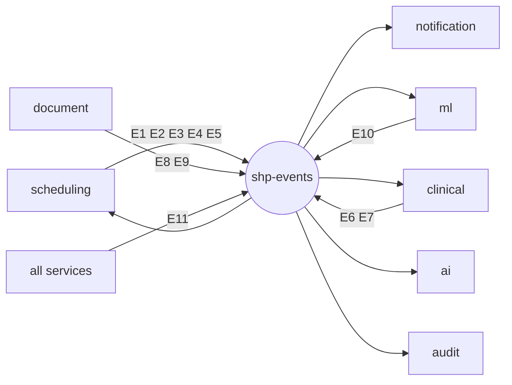

# 13 — Event catalog

## 1. Conventions

| Topic | Convention |
|---|---|
| Format | **CloudEvents 1.0**, JSON (`application/cloudevents+json`) |
| Name (`type`) | `shp.<context>.<event>.v<N>`; breaking changes → `v2`, published in parallel with `v1` for at least one sprint |
| Publishing | **Transactional outbox** (`outbox` table/collection in the same transaction as the data change); the relay polls every 1 second and publishes to the bus, marking `publishedAt` |
| Delivery | **At least once**; consumers **must be idempotent** using the `inbox` table (`consumer`, `messageId` = CloudEvents `id`) |
| Ordering | Guaranteed per `subject` (Service Bus: `SessionId = subject`; RabbitMQ: consistent-hash exchange by `subject`). In addition, the payload has `version` (the resource's versionId); consumers skip events with `version` ≤ the version already processed |
| Bus | Cloud: Azure Service Bus, 1 topic `shp-events`, each consumer has a subscription with a filter on `type`. Local: RabbitMQ topic exchange `shp-events`, each consumer has a queue. Same Spring Cloud Stream abstraction |
| Retry/DLQ | At most 5 deliveries (backoff 10 seconds, 1, 5, 15 minutes); exceeded → the subscription's dead-letter queue; alert when the DLQ has messages (OBS-03); replay tooling provided by SA |
| Data | **No PII**: only IDs, codes, times, statuses. No names, phone numbers, email, diagnosis, content |
| Trace | The CloudEvents extension `traceparent` carries trace context across the bus |
| Limit | ≤ 64 KB/event |

### 1.1 Implementation (library `libs/java/shp-messaging`)

| Topic | Implementation |
|---|---|
| Publishing | `StreamEventPublisher` (implements `EventPublisher`) sends via `StreamBridge` to the binding `shp-events-out-0` (destination `shp-events`); the body is the full CloudEvent JSON (structured) but declares content-type `application/json`, because with `application/cloudevents+json` Spring Cloud Function extracts the envelope into headers. The service's outbox relay calls this publisher |
| Headers on publish | `type` = CloudEvents `type` (Service Bus: application property used in the SQL filter `type IN (...)`; RabbitMQ: routing key); Service Bus: `MessageId` = CloudEvents `id` (the topic enables duplicate detection for 10 minutes), `SessionId` = `subject` |
| Binder | Both binders are available in the library, selected by `SHP_MESSAGING_BINDER`: `rabbit` (default, local) or `servicebus` (uat/prod, sign in with Workload Identity, no connection string) |
| Receiving | A service declares a `Consumer<Message<byte[]>>` bean built with `EventConsumers.idempotent(consumer, types, inbox, handler)`: parse + validate the schema, skip unregistered `type`s, process inside `inbox.handleOnce` (duplicate → skip). Binding `<name>-in-0`, destination `shp-events`, `group` = service name (RabbitMQ: queue `shp-events.<service>`; Service Bus: subscription with the same name, `session-enabled`) |
| Retry/DLQ | Handler throws an exception → no ack. Service Bus: no in-process retry; the broker redelivers up to `max_delivery_count = 5` then dead-letters. RabbitMQ: 5 in-process attempts (backoff 1 → 10 seconds, local does not need to wait 15 minutes) then moves to `shp-events.<service>.dlq` |
| Schema-invalid event | Treated as a permanent failure: throws `PoisonEventException`, enters the DLQ after 5 attempts as above; the log contains only `id`, `type`, and the failing field name (does not log `data`) |

### Sample envelope
```json
{
  "specversion": "1.0",
  "id": "0192f8a4-6c1e-7b2a-9f00-1a2b3c4d5e6f",
  "source": "/services/scheduling",
  "type": "shp.scheduling.appointment-booked.v1",
  "subject": "Appointment/0192f8a4-6c1e-7b2a-9f00-1a2b3c4d5e70",
  "time": "2026-11-20T02:15:00.123Z",
  "datacontenttype": "application/json",
  "dataschema": "https://shp.example.org/schemas/scheduling/appointment-booked/v1.json",
  "traceparent": "00-4bf92f3577b34da6a3ce929d0e0e4736-00f067aa0ba902b7-01",
  "data": { }
}
```
The JSON Schema for each `data` is in `contracts/events/<context>/<event>.v1.json` (task ARC-07); CI checks that producer/consumer match the schema.

## 2. Catalog

| # | `type` | Producer | Consumer | When |
|---|---|---|---|---|
| E1 | `shp.scheduling.appointment-booked.v1` | scheduling | notification, ml, clinical | `$book` succeeded |
| E2 | `shp.scheduling.appointment-cancelled.v1` | scheduling | notification, ml, clinical | `$cancel` succeeded |
| E3 | `shp.scheduling.appointment-rescheduled.v1` | scheduling | notification, ml, clinical | `$reschedule` succeeded |
| E4 | `shp.scheduling.appointment-checked-in.v1` | scheduling | clinical | `$check-in` |
| E5 | `shp.scheduling.appointment-status-changed.v1` | scheduling | ml, clinical | `noshow` (job), `fulfilled` (after E6) |
| E6 | `shp.clinical.encounter-finished.v1` | clinical | scheduling | `$finish` |
| E7 | `shp.clinical.patient-merged.v1` | clinical | scheduling, notification, ml, document | `$merge` |
| E8 | `shp.document.document-uploaded.v1` | document | ai | document scanned clean → `available` |
| E9 | `shp.document.document-released.v1` | document | notification | `release` |
| E10 | `shp.ml.no-show-scored.v1` | ml | notification | after processing E1 |
| E11 | `shp.audit.recorded.v1` | **every service** | audit | every operation that needs audit |

## 3. Payload (`data`)

### E1 `appointment-booked.v1`
```json
{
  "appointmentId": "0192...", "version": 1,
  "patientId": "0192...", "practitionerId": "0192...", "slotId": "0192...",
  "specialty": "cardiology", "start": "2026-12-03T01:15:00Z", "end": "2026-12-03T01:30:00Z",
  "channel": "web", "bookedAt": "2026-11-20T02:15:00Z", "ageBand": "40-49"
}
```
`ageBand` is **added by the relay at publish time** (it is not in the booking transaction): the relay calls
clinical's `GET /internal/v1/patients/{id}/age-band` (24-hour cache); error/timeout → `"unknown"`. As a result, booking
does not depend synchronously on clinical.

| Consumer | Processing |
|---|---|
| notification | Creates `booking-confirmation`, `t-24h`, `t-2h` reminders (skips milestones already past) |
| ml | Writes `appointment_fact`, scores, emits E10 |
| clinical | Updates `care_relationships` (adds the `appointment` source) |

### E2 `appointment-cancelled.v1`
`{ appointmentId, version, patientId, practitionerId, start, cancelReason, cancelledBy: "patient|staff", cancelledAt, hoursBeforeStart }`
— notification cancels unsent reminders and creates a `cancellation` reminder; ml sets `outcome=cancelled` (+ `late_cancel` if `hoursBeforeStart < 24`);
clinical removes the care relationship source (if no other source remains).

### E3 `appointment-rescheduled.v1`
`{ oldAppointmentId, newAppointmentId, version, patientId, practitionerId, oldStart, newStart, newEnd, specialty }` — handled as a
pair of cancel (old, `cancelReason=rescheduled`, not counted as `late_cancel`) + new booking, **in one event** so notification does not send
two contradictory notifications.

### E4 `appointment-checked-in.v1`
`{ appointmentId, version, patientId, practitionerId, specialty, checkedInAt }` — clinical creates an `arrived` `Encounter`
(idempotent thanks to the unique `search.appointmentId`).

### E5 `appointment-status-changed.v1`
`{ appointmentId, version, patientId, previousStatus, newStatus: "noshow|fulfilled", changedAt }`.

### E6 `encounter-finished.v1`
`{ encounterId, appointmentId, patientId, practitionerId, finishedAt, version }` — scheduling moves `Appointment arrived → fulfilled` (emits E5).

### E7 `patient-merged.v1`
`{ sourcePatientId, targetPatientId, mergedAt }` — consumers replace `patientId` in their own data with a background job, idempotent.

### E8 `document-uploaded.v1`
`{ documentId, version, patientId, encounterId, type: "11502-2", contentType, size, uploadedBy, availableAt }`; ai only creates a job for
`type ∈ {11502-2, 18748-4, 57833-6, 57133-1}`.

### E9 `document-released.v1`
`{ documentId, patientId, releasedAt, type }` — notification creates a `result-available` reminder (generic content, does not state the result type).

### E10 `no-show-scored.v1`
`{ appointmentId, patientId, start, score, threshold, highRisk, modelName, modelVersion, scoredAt }` — notification creates a `t-6h-risk` reminder if `highRisk` and `start - 6h` is still in the future (AC-15.1: without E10, reminders still work normally).

### E11 `audit.recorded.v1`
`data` follows the schema in [05](05-storage-audit-blob.md) §1.1. Every service emits it using the common library (audit middleware, task SHR-08).
If the bus is unavailable, the event stays in the outbox and is published when the bus recovers (audit is not lost).

## 4. Event flow diagram



## 5. Schema evolution rules
- Only **add optional fields** within the same version; consumers ignore unknown fields.
- Changing/deleting a field or changing its meaning → new version; the producer emits both versions during the transition period.
- Every new event must have: a JSON schema, an example, a consumer list, a contract test (the producer produces the correct schema; the consumer can read the example).
