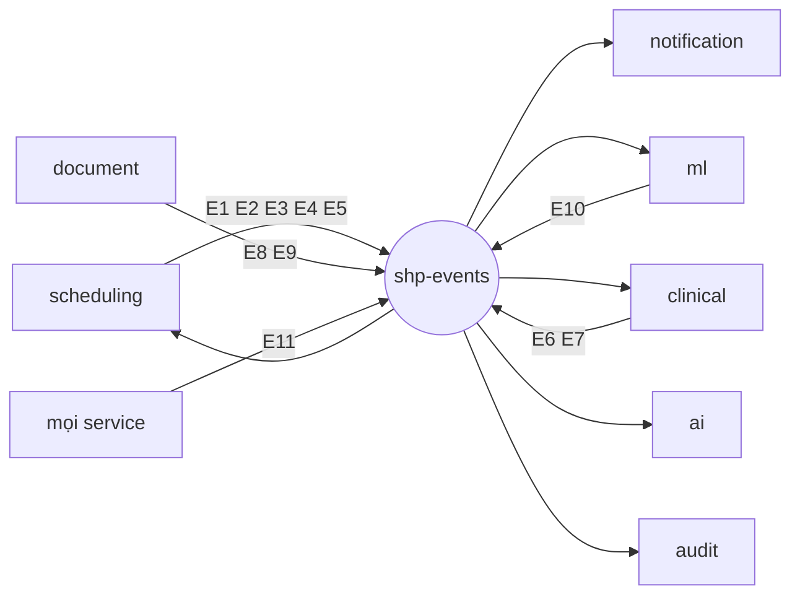

# 13 — Event catalog

## 1. Quy ước

| Chủ đề | Quy ước |
|---|---|
| Định dạng | **CloudEvents 1.0**, JSON (`application/cloudevents+json`) |
| Tên (`type`) | `shp.<context>.<event>.v<N>`; thay đổi phá vỡ tương thích → `v2`, phát song song với `v1` ít nhất một sprint |
| Phát | **Transactional outbox** (bảng/collection `outbox` cùng transaction với thay đổi dữ liệu); relay poll mỗi 1 giây và phát lên bus, đánh dấu `publishedAt` |
| Giao | **Ít nhất một lần**; consumer **bắt buộc idempotent** bằng bảng `inbox` (`consumer`, `messageId` = CloudEvents `id`) |
| Thứ tự | Bảo đảm theo `subject` (Service Bus: `SessionId = subject`; RabbitMQ: consistent-hash exchange theo `subject`). Ngoài ra payload có `version` (versionId của resource); consumer bỏ qua event có `version` ≤ version đã xử lý |
| Bus | Cloud: Azure Service Bus, 1 topic `shp-events`, mỗi consumer một subscription có filter theo `type`. Local: RabbitMQ topic exchange `shp-events`, mỗi consumer một queue. Cùng abstraction MassTransit |
| Retry/DLQ | Tối đa 5 lần giao (backoff 10 giây, 1, 5, 15 phút); vượt → dead-letter queue của subscription; cảnh báo khi DLQ có message (OBS-03); tooling replay do SA cung cấp |
| Dữ liệu | **Không có PII**: chỉ ID, mã, thời điểm, trạng thái. Không tên, SĐT, email, chẩn đoán, nội dung |
| Trace | CloudEvents extension `traceparent` mang trace context xuyên bus |
| Giới hạn | ≤ 64 KB/event |

### Envelope mẫu
```json
{
  "specversion": "1.0",
  "id": "0192f8a4-6c1e-7b2a-9f00-1a2b3c4d5e6f",
  "source": "/services/scheduling",
  "type": "shp.scheduling.appointment-booked.v1",
  "subject": "Appointment/0192f8a4-6c1e-7b2a-9f00-1a2b3c4d5e70",
  "time": "2026-11-20T02:15:00.123Z",
  "datacontenttype": "application/json",
  "dataschema": "https://shp.example.org/schemas/scheduling/appointment-booked/v1.json",
  "traceparent": "00-4bf92f3577b34da6a3ce929d0e0e4736-00f067aa0ba902b7-01",
  "data": { }
}
```
Schema JSON của từng `data` nằm trong `contracts/events/<context>/<event>.v1.json` (task ARC-07); CI kiểm tra producer/consumer khớp schema.

## 2. Danh mục

| # | `type` | Producer | Consumer | Khi nào |
|---|---|---|---|---|
| E1 | `shp.scheduling.appointment-booked.v1` | scheduling | notification, ml, clinical | `$book` thành công |
| E2 | `shp.scheduling.appointment-cancelled.v1` | scheduling | notification, ml, clinical | `$cancel` thành công |
| E3 | `shp.scheduling.appointment-rescheduled.v1` | scheduling | notification, ml, clinical | `$reschedule` thành công |
| E4 | `shp.scheduling.appointment-checked-in.v1` | scheduling | clinical | `$check-in` |
| E5 | `shp.scheduling.appointment-status-changed.v1` | scheduling | ml, clinical | `noshow` (job), `fulfilled` (sau E6) |
| E6 | `shp.clinical.encounter-finished.v1` | clinical | scheduling | `$finish` |
| E7 | `shp.clinical.patient-merged.v1` | clinical | scheduling, notification, ml, document | `$merge` |
| E8 | `shp.document.document-uploaded.v1` | document | ai | tài liệu quét sạch → `available` |
| E9 | `shp.document.document-released.v1` | document | notification | `release` |
| E10 | `shp.ml.no-show-scored.v1` | ml | notification | sau khi xử lý E1 |
| E11 | `shp.audit.recorded.v1` | **mọi service** | audit | mỗi thao tác cần audit |

## 3. Payload (`data`)

### E1 `appointment-booked.v1`
```json
{
  "appointmentId": "0192...", "version": 1,
  "patientId": "0192...", "practitionerId": "0192...", "slotId": "0192...",
  "specialty": "cardiology", "start": "2026-12-03T01:15:00Z", "end": "2026-12-03T01:30:00Z",
  "channel": "web", "bookedAt": "2026-11-20T02:15:00Z", "ageBand": "40-49"
}
```
`ageBand` được **relay thêm vào lúc phát** (không nằm trong transaction đặt lịch): relay gọi
`GET /internal/v1/patients/{id}/age-band` của clinical (cache 24 giờ); lỗi/timeout → `"unknown"`. Nhờ đó đặt lịch
không phụ thuộc đồng bộ vào clinical.

| Consumer | Xử lý |
|---|---|
| notification | Tạo nhắc `booking-confirmation`, `t-24h`, `t-2h` (bỏ mốc đã qua) |
| ml | Ghi `appointment_fact`, chấm điểm, phát E10 |
| clinical | Cập nhật `care_relationships` (thêm nguồn `appointment`) |

### E2 `appointment-cancelled.v1`
`{ appointmentId, version, patientId, practitionerId, start, cancelReason, cancelledBy: "patient|staff", cancelledAt, hoursBeforeStart }`
— notification hủy các nhắc chưa gửi và tạo nhắc `cancellation`; ml đặt `outcome=cancelled` (+ `late_cancel` nếu `hoursBeforeStart < 24`);
clinical gỡ nguồn quan hệ điều trị (nếu không còn nguồn nào khác).

### E3 `appointment-rescheduled.v1`
`{ oldAppointmentId, newAppointmentId, version, patientId, practitionerId, oldStart, newStart, newEnd, specialty }` — xử lý như một
cặp hủy (cũ, `cancelReason=rescheduled`, không tính `late_cancel`) + đặt mới, **trong một event** để notification không gửi
hai thông báo trái nhau.

### E4 `appointment-checked-in.v1`
`{ appointmentId, version, patientId, practitionerId, specialty, checkedInAt }` — clinical tạo `Encounter` `arrived`
(idempotent nhờ unique `search.appointmentId`).

### E5 `appointment-status-changed.v1`
`{ appointmentId, version, patientId, previousStatus, newStatus: "noshow|fulfilled", changedAt }`.

### E6 `encounter-finished.v1`
`{ encounterId, appointmentId, patientId, practitionerId, finishedAt, version }` — scheduling chuyển `Appointment arrived → fulfilled` (phát E5).

### E7 `patient-merged.v1`
`{ sourcePatientId, targetPatientId, mergedAt }` — consumer thay `patientId` trong dữ liệu của mình bằng job nền, idempotent.

### E8 `document-uploaded.v1`
`{ documentId, version, patientId, encounterId, type: "11502-2", contentType, size, uploadedBy, availableAt }`; ai chỉ tạo job cho
`type ∈ {11502-2, 18748-4, 57833-6, 57133-1}`.

### E9 `document-released.v1`
`{ documentId, patientId, releasedAt, type }` — notification tạo nhắc `result-available` (nội dung chung chung, không nêu loại kết quả).

### E10 `no-show-scored.v1`
`{ appointmentId, patientId, start, score, threshold, highRisk, modelName, modelVersion, scoredAt }` — notification tạo nhắc `t-6h-risk` nếu `highRisk` và `start - 6h` còn ở tương lai (AC-15.1: không có E10 vẫn nhắc bình thường).

### E11 `audit.recorded.v1`
`data` đúng lược đồ ở [05](05-storage-audit-blob.md) §1.1. Mọi service phát bằng thư viện chung (middleware audit, task SHR-08).
Nếu bus không khả dụng, event vẫn nằm trong outbox và được phát khi bus phục hồi (không mất audit).

## 4. Sơ đồ luồng event



## 5. Quy tắc tiến hóa schema
- Chỉ **thêm trường tùy chọn** trong cùng version; consumer bỏ qua trường lạ.
- Đổi/xóa trường hoặc đổi ý nghĩa → version mới; producer phát cả hai version trong giai đoạn chuyển tiếp.
- Mọi event mới phải có: schema JSON, ví dụ, danh sách consumer, test hợp đồng (producer sinh đúng schema; consumer đọc được ví dụ).
