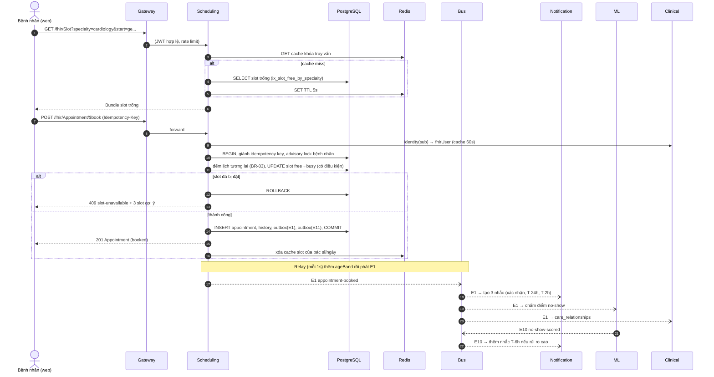
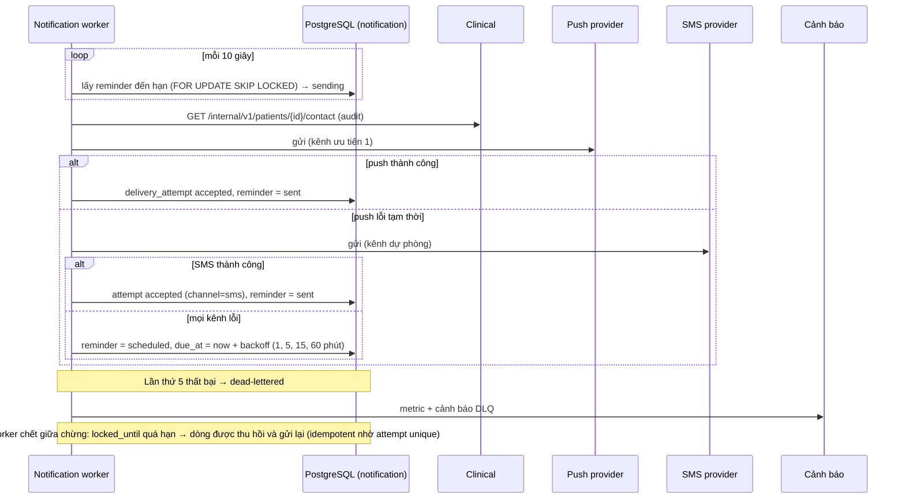
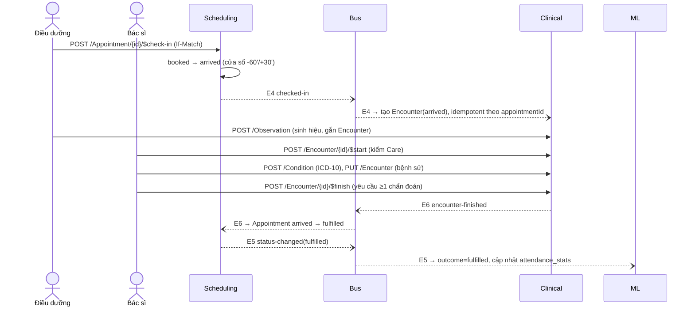
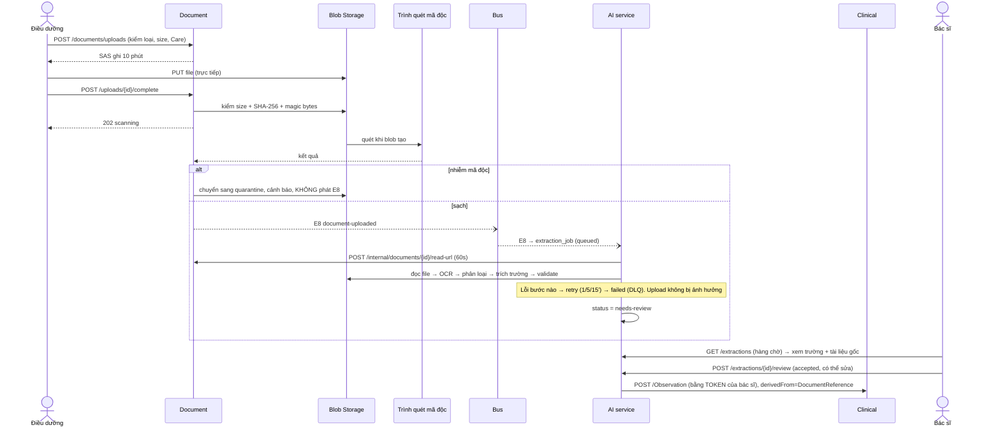
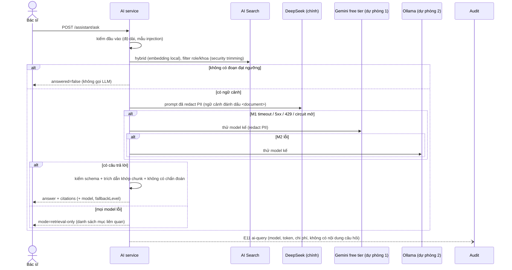
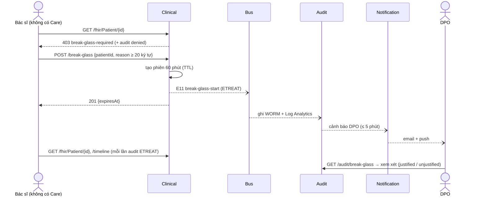

# 14 — Sequence diagram các luồng chính

Mỗi sơ đồ ghi rõ chỗ **đồng bộ** (mũi tên liền), **bất đồng bộ** (mũi tên đứt), và điểm lỗi. Mã API (S11, C14...) tham chiếu
tài liệu 08–12; mã event (E1...) tham chiếu [13](13-events.md).

## 1. Đặt lịch (UC-03) — S11, E1

**Điểm lỗi:** Redis chết → bỏ qua cache, đọc thẳng DB (chậm hơn, đúng). Clinical chậm → identity dùng cache; cache rỗng và clinical
chết → 503 (không đặt lịch khi không xác định được người dùng). Bus chết → E1 nằm trong outbox, phát sau; lịch hẹn vẫn đặt thành công.

## 2. Nhắc lịch và xử lý nhà cung cấp lỗi (UC-07)

## 3. Check-in → lần khám → kết thúc (UC-04) — S16, C11, C14, E4–E6

## 4. Tải tài liệu và trích xuất AI (UC-05, UC-13) — D1, D2, E8, AI6

## 5. Hỏi trợ lý tri thức với fallback (UC-11) — AI1

## 6. Truy cập khẩn cấp — break-glass (UC-10) — C20

