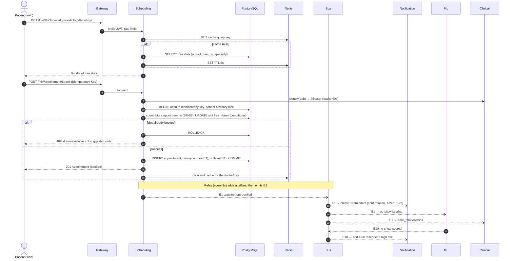
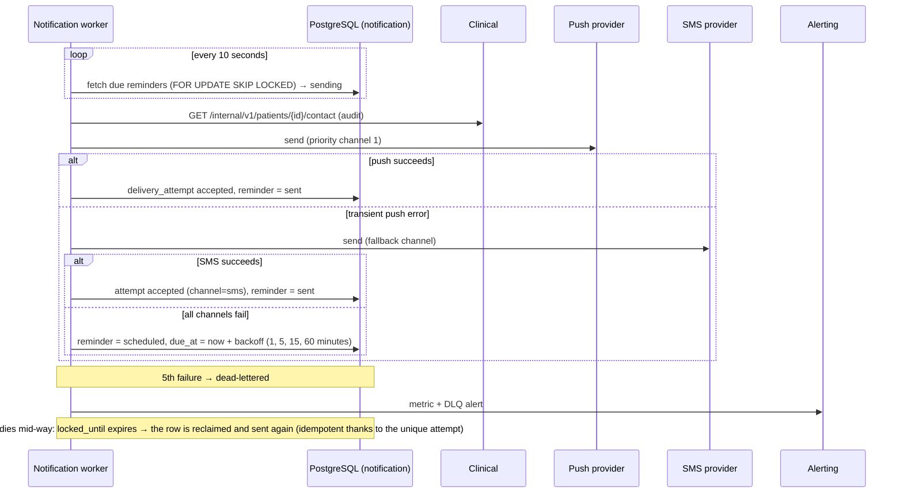
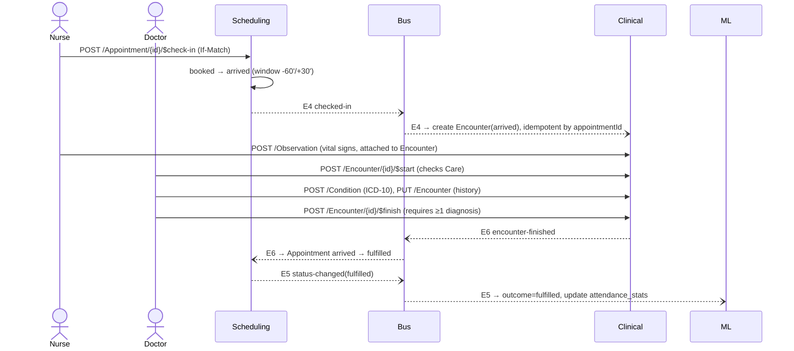
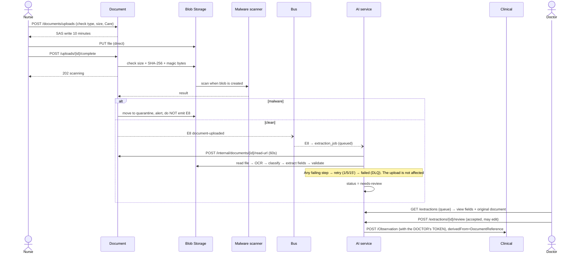
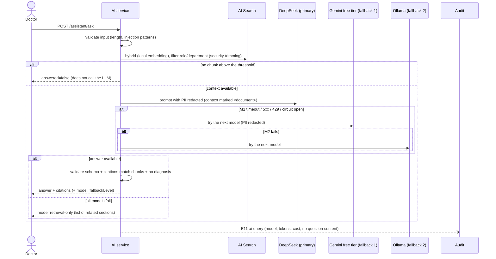
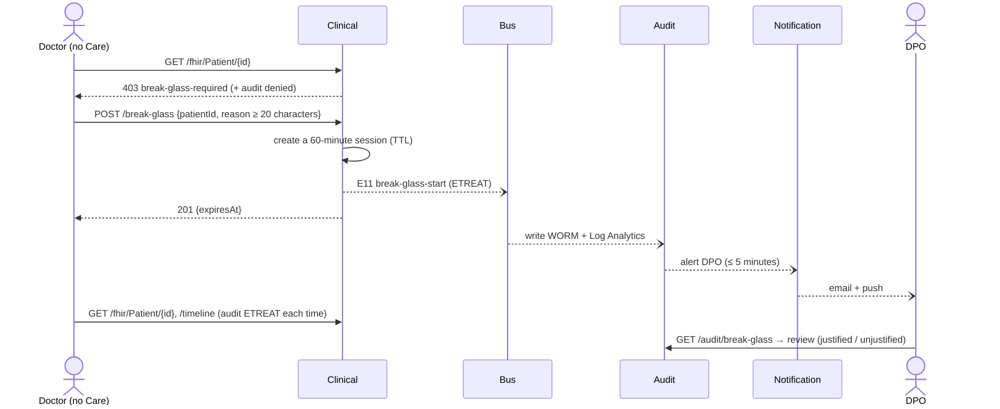

# 14 — Sequence diagrams for main flows

Each diagram marks the **synchronous** points (solid arrows), **asynchronous** points (dashed arrows), and failure points. API codes (S11, C14, etc.) reference
documents 08–12; event codes (E1, etc.) reference [13](13-events.md).

## 1. Booking (UC-03) — S11, E1

**Failure points:** Redis down → skip the cache, read directly from the DB (slower, correct). Clinical slow → identity uses the cache; cache empty and clinical
down → 503 (do not book when the user cannot be identified). Bus down → E1 stays in the outbox and is published later; the appointment is still booked successfully.

## 2. Reminders and provider failure handling (UC-07)

## 3. Check-in → visit → finish (UC-04) — S16, C11, C14, E4–E6

## 4. Document upload and AI extraction (UC-05, UC-13) — D1, D2, E8, AI6

## 5. Knowledge assistant with fallback (UC-11) — AI1

## 6. Emergency access — break-glass (UC-10) — C20

