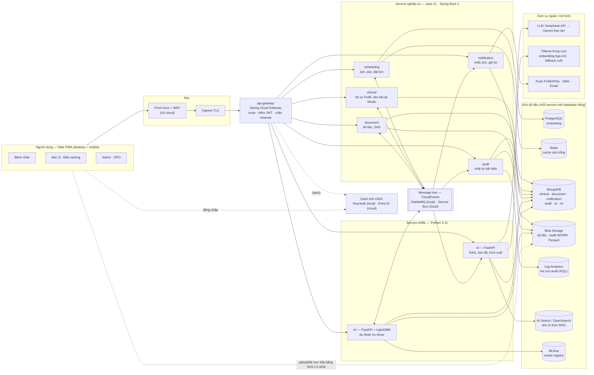
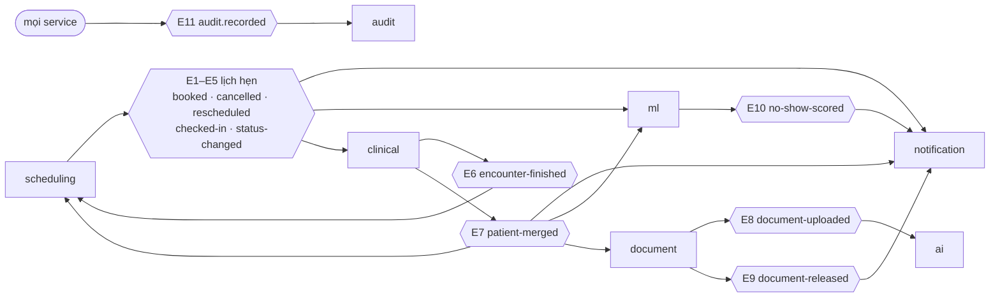
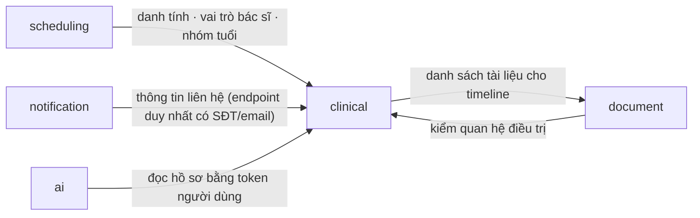
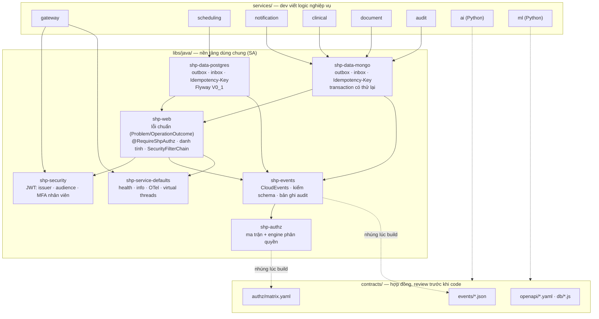
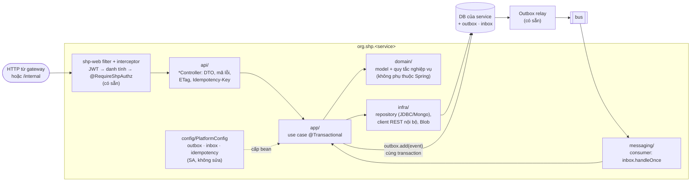

# Kiến trúc tổng quan — Smart Hospital Platform

> Trạng thái: **Approved — G3 qua ngày 2026-10-26**.
>
> Project 5 — Cloud Application Development. Một hệ thống microservice gọn, FHIR-native, chạy trên Azure nhưng không khóa chặt vào Azure.
> Chỉ dùng **dữ liệu bệnh nhân giả (synthetic)**.

Mục lục: [1. Sơ đồ tổng thể](#1-sơ-đồ-kiến-trúc-tổng-thể) · [2. Giao tiếp giữa các module](#2-giao-tiếp-giữa-các-module) ·
[3. Module mã nguồn](#3-module-mã-nguồn) · [4. Bên trong một service Java](#4-bên-trong-một-service-java) · [5. Luồng nghiệp vụ](#5-luồng-nghiệp-vụ-end-to-end-vertical-slice-chính) ·
[6. Service catalog](#6-service-catalog) · [7. Hạ tầng Azure ↔ portable](#7-ánh-xạ-hạ-tầng-azure--portable) · [8. Bảo mật](#8-bảo-mật-tóm-tắt--chi-tiết-ở-threat-model-p3)

## 1. Sơ đồ kiến trúc tổng thể

Hệ thống gồm **8 service** chạy trên Kubernetes:
- **6 service Java**: `api-gateway` + 5 service nghiệp vụ.
- **2 service Python**: `ai`, `ml`.

Các service nói chuyện với nhau theo hai cách:
- **Đồng bộ**: REST, luôn qua gateway từ phía client.
- **Bất đồng bộ**: event CloudEvents trên message bus.

Mỗi service **sở hữu kho dữ liệu riêng**.



Ghi chú về sơ đồ:
- **Ranh giới tin cậy.** Mọi request từ ngoài đi qua WAF (cloud), Ingress, rồi gateway.
  - Gateway kiểm token ở biên.
  - Từng service **kiểm lại token** và phân quyền chi tiết theo [ma trận](detailed-design/15-authorization.md).
  - Đường `/internal/**` không có route ở gateway; chỉ các service trong cụm gọi được.
- **Dữ liệu ra ngoài cụm.**
  - Chỉ `ai` gọi LLM bên ngoài, và phải che PII trước khi gửi.
  - Chỉ `notification` gọi nhà cung cấp tin nhắn.
  - Quy tắc cho values uat/prod: chỉ hai service này được mở egress ra Internet (chart `microservice` có `networkPolicy.egress`).
    Local (kind) tắt NetworkPolicy.
- **Quan sát.** Mọi service xuất trace/metric/log bằng OpenTelemetry (không vẽ cho gọn), xem §7.

## 2. Giao tiếp giữa các module

### 2.1 Bất đồng bộ — event trên bus
Mô hình **outbox → bus → inbox**:
- Producer ghi dữ liệu và event trong **cùng một transaction**.
- Bus giao ít nhất một lần.
- Consumer xử lý mỗi event **đúng một lần** nhờ inbox.

Mỗi hình lục giác là một nhóm event (topic `shp-events`, lọc theo `type`). Chi tiết: [13-events.md](detailed-design/13-events.md).



Ai nhận event nào trong nhóm E1–E5 (sơ đồ gộp cho gọn):

| Event | Consumer |
|---|---|
| E1–E3 | notification, ml, clinical |
| E4 checked-in | clinical |
| E5 status-changed | ml, clinical |

### 2.2 Đồng bộ — REST nội bộ `/internal/v1/**`
- Chỉ gọi được từ trong cụm; gateway không có route tới đây.
- Có timeout; mỗi lần đọc dữ liệu nhạy cảm đều ghi audit.
- Endpoint: [09-api-clinical.md](detailed-design/09-api-clinical.md) §4.

`ai` gọi API công khai của clinical **bằng token của người dùng** (on-behalf-of), không dùng quyền riêng.



## 3. Module mã nguồn

Repo ứng dụng là một **Maven multi-module** cho phần Java, cộng hai project Python độc lập. Mỗi service có:
- Dockerfile và pipeline `.github/workflows/svc-<tên>.yml` riêng;
- `deploy/values-local.yaml` cho cụm kind.

```text
pom.xml                         # Maven gốc: Spring Boot 4.1.2, Java 21, Spotless, JaCoCo ≥ 70%, -Werror
libs/java/shp-*/                # 7 thư viện dùng chung (SA viết, dev chỉ dùng)
services/<6 service Java>/      # gateway, scheduling, notification, clinical, document, audit
services/ai/  services/ml/      # Python 3.12 (pyproject, ruff, mypy, pytest)
contracts/                      # nguồn sự thật: openapi, events (JSON Schema), authz/matrix.yaml, terminology, db
dev/                            # cụm kind + Helm cho chạy local (make -C dev ...)
tools/                          # scaffold service, kiểm hợp đồng, sinh kế hoạch
docs/                           # BA, yêu cầu, kiến trúc, DevOps, kế hoạch
```

Quan hệ phụ thuộc giữa các module (mũi tên = "dùng"):



Ghi chú:
- Service chỉ khai báo trực tiếp `shp-data-*`, phần còn lại (`shp-web`, `shp-events`, …) đi kèm theo.
  Gateway là WebFlux nên chỉ dùng `shp-security` + `shp-service-defaults`, không kéo Spring MVC.
- Schema event và ma trận phân quyền được **nhúng vào jar lúc build**, nên service luôn chạy đúng bản đã review.
- Mọi service hiện thực đúng `contracts/openapi`; `contracts/db/*.js` khởi tạo collection cho notification/ml.
- `ai`, `ml` đọc cùng schema/matrix qua thư viện Python (PY-01..05, D3).

| Module | Vai trò | Ai sửa |
|---|---|---|
| `shp-service-defaults` | Cấu hình chung mọi service: actuator `/health/{liveness,readiness}`, `/info`, `/prometheus`; OTel; tắt êm; virtual threads | SA |
| `shp-authz` | Đọc `contracts/authz/matrix.yaml` (nhúng), `AuthorizationEngine.decide` — mặc định từ chối | SA |
| `shp-events` | `CloudEvents.create` (UUIDv7, traceparent, ≤ 64 KB), `EventSchemas.validate`, `AuditRecordBuilder` (che IP) | SA |
| `shp-security` | Quy tắc JWT dùng chung cho servlet (service) và reactive (gateway) | SA |
| `shp-web` | Bắt lỗi → Problem Details; `@RequireShpAuthz` (test đỏ nếu endpoint quên); phân giải danh tính `sub → Patient/…`; `IdempotencyKeys` | SA |
| `shp-data-postgres` | Outbox + relay (`SKIP LOCKED`), inbox, Idempotency-Key, sink audit — bảng do Flyway tạo | SA |
| `shp-data-mongo` | Như trên cho MongoDB (`findAndModify` + `lockedUntil`), `MongoMessaging.inTransaction` | SA |
| `services/*` (trừ gateway) | Controller, nghiệp vụ, truy cập dữ liệu, consumer của service | D1 (scheduling, notification) · D2 (clinical, document, audit) · D3 (ai, ml) |

## 4. Bên trong một service Java

Mọi service Java dùng cùng một bố cục gói (khung do `tools/scaffold/java_service.py` sinh). Dev chỉ thêm code vào các gói
`api`, `app`, `domain`, `infra`, `messaging`. Gói `config` là của SA.



Quy tắc:
- **Controller** chỉ làm việc HTTP: map DTO và gọi use case. Mọi endpoint có `@RequireShpAuthz`.
- **Use case** (`app/`) là nơi duy nhất mở transaction. Thay đổi dữ liệu và `outbox.add(...)` nằm trong **cùng** một transaction.
- **domain/** không import Spring/JDBC/Mongo, nên test thuần JUnit, nhanh.
- **Test:**
  - Unit test cho `domain/` và `app/`.
  - Test tích hợp (Testcontainers, DB thật) cho `infra/`, API và consumer.
  - Coverage dòng ≥ 70% mỗi module (CI chặn).
- Service Python (`ai`, `ml`) chia module con trong `src/shp_ai`, `src/shp_ml` theo cùng cách: `api/` (FastAPI router), `app/`, `domain/`, `infra/`, `messaging/`.

## 5. Luồng nghiệp vụ end-to-end (vertical slice chính)

```
Bệnh nhân tìm slot trống ──► đặt lịch (idempotent, chống double-booking)
        │                              │ AppointmentBooked (outbox → message bus)
        │                              ▼
        │                   notification-service lên lịch nhắc (T-24h, T-2h)
        │                              │  ml-service: điểm rủi ro no-show → nhắc thêm nếu cao
        ▼                              ▼
Bác sĩ khám ──► Encounter ──► upload kết quả (PDF/ảnh) ──► document-service (Blob)
                                                  │ DocumentUploaded
                                                  ▼
                                    ai-service: trích xuất trường (OCR + LLM, human review)
Bác sĩ hỏi AI: tóm tắt hồ sơ / tra cứu phác đồ (RAG có trích dẫn)
Mọi lần đọc/ghi dữ liệu nhạy cảm ──► audit-service (append-only)
```

## 6. Service catalog

| Service | Ngôn ngữ | Sở hữu dữ liệu (FHIR) | Đồng bộ / bất đồng bộ | Dev |
|---|---|---|---|---|
| `api-gateway` | Java (Spring Cloud Gateway) | — | Định tuyến, xác thực JWT, rate limit | SA |
| `clinical-service` | Java | Patient, Practitioner, PractitionerRole, Encounter, Observation, Condition, AllergyIntolerance + liên kết tài khoản + quan hệ điều trị | REST FHIR; nghe event lịch hẹn | D2 |
| `scheduling-service` | Java | Schedule, Slot, Appointment | REST FHIR + outbox; nghe `encounter-finished` | D1 |
| `document-service` | Java | DocumentReference + file trên Blob | REST + event `document-uploaded`, `document-released` | D2 |
| `notification-service` | Java worker | Nhắc lịch (`reminder`), lần gửi, tùy chọn nhận tin | Consume event, retry + DLQ | D1 |
| `audit-service` | Java worker | AuditEvent (append-only) | Consume event | D2 |
| `ai-service` | Python (FastAPI) | Kho tri thức RAG (AI Search) | REST; gọi các service khác bằng token của người dùng | D3 |
| `ml-service` | Python (LightGBM, MLflow) | Đặc trưng, dự đoán, model registry (MLflow) | Consume event, phát `no-show-scored` | D3 |

Nguyên tắc: **mỗi service sở hữu kho dữ liệu riêng, chọn theo đặc tính tải**
(xem [ADR-0008](adr/0008-polyglot-persistence.md)); không join chéo service, chỉ tham chiếu
bằng FHIR `Reference` (`Patient/123`).

| Service | Kho dữ liệu |
|---|---|
| scheduling | PostgreSQL (ACID, chống double-booking) + Redis (cache slot trống) |
| clinical | MongoDB API / Cosmos DB for MongoDB vCore (document FHIR, partition theo bệnh nhân) |
| notification | MongoDB (nhắc lịch: lấy việc nguyên tử + `lockedUntil`, TTL) — ADR-0014 |
| document | MongoDB (metadata) + Azure Blob Storage (SAS ngắn hạn, lifecycle Hot→Cool) |
| audit | Blob immutable (WORM) + Log Analytics (KQL); MongoDB chỉ cho inbox/outbox |
| ai | Azure AI Search (hybrid + rerank) + MongoDB (hội thoại, job trích xuất) |
| ml | MongoDB (trạng thái đặc trưng, nhật ký dự đoán) + Parquet trên Blob + MLflow — ADR-0014 |

Thiết kế chi tiết từng kho dữ liệu, API, event và phân quyền: [detailed-design](detailed-design/README.md).

Ranh giới service dựa trên **khác biệt về tải và yêu cầu phi chức năng**, không chia theo
từng resource: scheduling có tranh chấp ghi (concurrency), document có I/O file lớn,
AI có độ trễ/chi phí token và phụ thuộc nhà cung cấp ngoài, notification phải chịu được
provider lỗi. Xem [ADR-0001](adr/0001-microservice-boundaries.md).

## 7. Ánh xạ hạ tầng: Azure ↔ portable

| Năng lực | Azure (production) | Portable / local (docker-compose, K8s bất kỳ) | Lớp trừu tượng |
|---|---|---|---|
| Compute | AKS (2 cluster: nonprod, prod) + Argo CD + KEDA | kind / K8s bất kỳ, cùng Helm chart | Container OCI + Helm |
| DB quan hệ | Azure Database for PostgreSQL Flexible (PITR) | PostgreSQL 16 | Spring JDBC/Flyway (`shp-data-postgres`) |
| DB document | Cosmos DB for MongoDB vCore | MongoDB 8 | Spring Data MongoDB (`shp-data-mongo`, `FhirStore` — SHR-10) |
| Search/vector | Azure AI Search | OpenSearch | `Retriever` (Python, ai) |
| Audit | Blob immutable + Log Analytics | Azurite (không có WORM) + Loki (profile `full`) | `AuditSink` (`shp-events`) |
| Message bus | Azure Service Bus | RabbitMQ | Spring Cloud Stream (Java) · client AMQP (Python) |
| Object storage | Azure Blob Storage | Azurite (giả lập Azure Blob, cùng SDK) — ADR-0012 | Azure Storage SDK (`BlobStore`) |
| Cache | Azure Cache for Redis | Redis | Spring Data Redis |
| Identity | Microsoft Entra ID (OIDC) | Keycloak (OIDC) | JWT Bearer chuẩn OIDC |
| Secret | Key Vault (CSI) + Workload Identity | env / K8s Secret | biến môi trường → Spring `Environment` |
| Observability | Azure Monitor / App Insights | Grafana + Tempo + Prometheus | OpenTelemetry (OTLP) |
| LLM | DeepSeek API → Gemini free tier → Ollama trong cụm (embedding bge-m3) — ADR-0013 | Ollama | router của `ai` |
| ML | Azure ML / MLflow | MLflow | MLflow model format |

Xem [ADR-0004](adr/0004-azure-first-portable.md).

## 8. Bảo mật (tóm tắt — chi tiết ở threat model P3)

- OIDC + JWT; role: `patient`, `practitioner`, `nurse`, `admin`. Claim `fhir_user`
  (`Patient/123`) dùng cho phân quyền theo đối tượng (patient chỉ thấy dữ liệu của mình).
- Ma trận phân quyền được kiểm thử tự động (xem `tests/`).
- Tài liệu chỉ truy cập qua SAS URL ngắn hạn (≤ 5 phút), không public blob.
- Mã hóa at-rest (Postgres, Blob) và TLS in-transit; secret chỉ nằm trong Key Vault.
- AI: redact PII trước khi gửi tới provider ngoài Azure, chống prompt injection, giới hạn
  tool theo quyền của người gọi.

