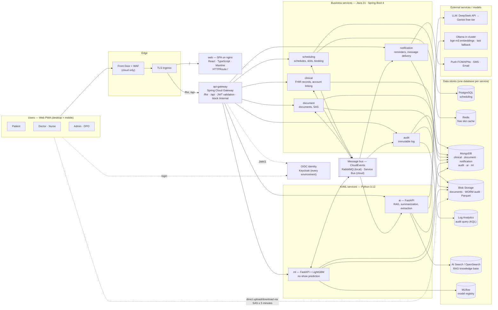
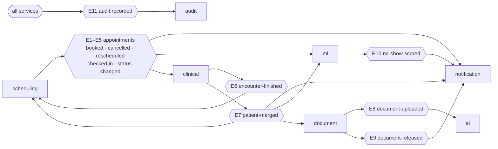
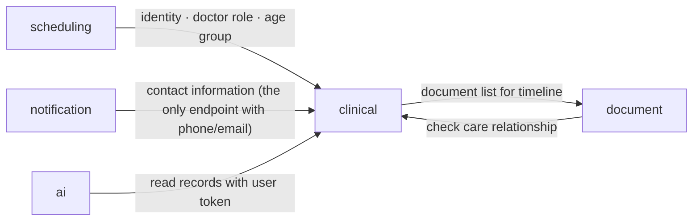
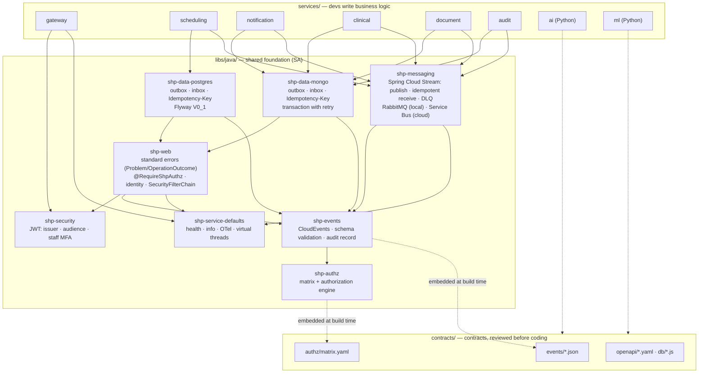
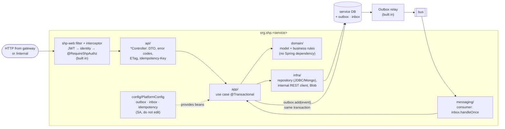

# Architecture Overview — Smart Hospital Platform

> Status: **Approved — G3 passed on 2026-10-26**.
>
> Project 5 — Cloud Application Development. A concise, FHIR-native microservice system, running on Azure but not tightly locked to Azure.
> Uses only **synthetic patient data**.
>
> Detailed diagrams per view (C4, Azure deployment, network trust zones, identity, data protection, CI/CD, environments, observability, AI/ML):
> [architecture-diagrams.md](architecture-diagrams.md).

Contents: [1. Overall architecture diagram](#1-overall-architecture-diagram) · [2. Communication between modules](#2-communication-between-modules) ·
[3. Source modules](#3-source-modules) · [4. Inside a Java service](#4-inside-a-java-service) · [5. Business flows](#5-end-to-end-business-flow-main-vertical-slice) ·
[6. Service catalog](#6-service-catalog) · [7. Infrastructure mapping: Azure ↔ portable](#7-infrastructure-mapping-azure--portable) · [8. Security](#8-security-summary--details-in-the-p3-threat-model)

## 1. Overall architecture diagram

The system consists of **8 services** running on Kubernetes:
- **6 Java services**: `api-gateway` + 5 business services.
- **2 Python services**: `ai`, `ml`.

Services communicate in two ways:
- **Synchronous**: REST, always through the gateway from the client side.
- **Asynchronous**: CloudEvents on the message bus.

Each service **owns its own data store**.



Notes on the diagram:
- **Web interface** ([ADR-0016](adr/0016-frontend-web-app.md)): `web` only serves static files (SPA). The browser loads the SPA from `/`, logs in with OIDC (PKCE) against Keycloak (the same registration UI by phone number or email in every environment),
  then calls same-origin APIs through `/fhir`, `/api` → gateway (no CORS needed). Role-based menus are navigation only; actual permissions are enforced by the backend.
- **Trust boundary.** Every external request passes through WAF (cloud), Ingress, then the gateway.
  - The gateway validates the token at the edge.
  - Each service **re-validates the token** and enforces detailed authorization per the [matrix](detailed-design/15-authorization.md).
  - The `/internal/**` path has no route at the gateway; only services inside the cluster can call it.
- **Data leaving the cluster.**
  - Only `ai` calls external LLMs, and must mask PII before sending.
  - Only `notification` calls messaging providers.
  - Rule for uat/prod values: only these two services may open egress to the Internet (the `microservice` chart has `networkPolicy.egress`).
    Local (kind) disables NetworkPolicy.
- **Observability.** All services export traces/metrics/logs via OpenTelemetry (not drawn for brevity), see §7.

## 2. Communication between modules

### 2.1 Asynchronous — events on the bus
**outbox → bus → inbox** model:
- The producer writes data and the event in the **same transaction**.
- The bus delivers at least once.
- The consumer processes each event **exactly once** via the inbox.

Each hexagon is an event group (topic `shp-events`, filtered by `type`). Details: [13-events.md](detailed-design/13-events.md).



Which events each consumer receives in group E1–E5 (diagram merged for brevity):

| Event | Consumer |
|---|---|
| E1–E3 | notification, ml, clinical |
| E4 checked-in | clinical |
| E5 status-changed | ml, clinical |

### 2.2 Synchronous — internal REST `/internal/v1/**`
- Callable only from inside the cluster; the gateway has no route here.
- Has a timeout; every read of sensitive data writes an audit record.
- Endpoint: [09-api-clinical.md](detailed-design/09-api-clinical.md) §4.

`ai` calls clinical's public API **with the user's token** (on-behalf-of), not with its own permissions.



## 3. Source modules

The application repo is one **Maven multi-module** for the Java part, plus two independent Python projects. Each service has:
- A Dockerfile and its own `.github/workflows/svc-<name>.yml` pipeline;
- `deploy/values-local.yaml` for the kind cluster.

```text
pom.xml                         # Root Maven: Spring Boot 4.1.2, Java 21, Spotless, JaCoCo ≥ 70%, -Werror
libs/java/shp-*/                # 7 shared libraries (written by SA, devs only use them)
services/<6 Java services>/     # gateway, scheduling, notification, clinical, document, audit
services/ai/  services/ml/      # Python 3.12 (pyproject, ruff, mypy, pytest)
contracts/                      # source of truth: openapi, events (JSON Schema), authz/matrix.yaml, terminology, db
dev/                            # kind cluster + Helm for local runs (make -C dev ...)
tools/                          # scaffold services, contract checks, generate plans
docs/                           # BA, requirements, architecture, DevOps, plan
```

Dependency relationships between modules (arrow = "uses"):



Notes:
- Services declare only `shp-data-*` and `shp-messaging` directly; the rest (`shp-web`, `shp-events`, …) comes transitively.
  The gateway is WebFlux, so it uses only `shp-security` + `shp-service-defaults` and does not pull in Spring MVC.
- Event schemas and the authorization matrix are **embedded into the jar at build time**, so services always run the reviewed version.
- All services implement `contracts/openapi` correctly; `contracts/db/*.js` initializes collections for notification/ml.
- `ai`, `ml` read the same schema/matrix through Python libraries (PY-01..05, SA).

| Module | Role | Who edits |
|---|---|---|
| `shp-service-defaults` | Common configuration for all services: actuator `/health/{liveness,readiness}`, `/info`, `/prometheus`; OTel; graceful shutdown; virtual threads | SA |
| `shp-authz` | Reads `contracts/authz/matrix.yaml` (embedded), `AuthorizationEngine.decide` — deny by default | SA |
| `shp-events` | `CloudEvents.create` (UUIDv7, traceparent, ≤ 64 KB), `EventSchemas.validate`, `AuditRecordBuilder` (IP masking) | SA |
| `shp-security` | Shared JWT rules for servlet (services) and reactive (gateway) | SA |
| `shp-web` | Error handling → Problem Details; `@RequireShpAuthz` (red test if an endpoint forgets it); identity resolution `sub → Patient/…`; `IdempotencyKeys` | SA |
| `shp-data-postgres` | Outbox + relay (`SKIP LOCKED`), inbox, Idempotency-Key, audit sink — tables created by Flyway | SA |
| `shp-data-mongo` | As above for MongoDB (`findAndModify` + `lockedUntil`), `MongoMessaging.inTransaction` | SA |
| `shp-messaging` | `StreamEventPublisher` (outbox relay publishes via Spring Cloud Stream), `EventConsumers.idempotent` (schema check + inbox), default binder, retry and DLQ ([13-events §1.1](detailed-design/13-events.md#11-implementation-library-libsjavashp-messaging)) | SA |
| `services/*` (except gateway) | Controllers, business logic, data access, service consumers | D1 (scheduling) · D2 (clinical) · D3 (notification, document, audit, gateway) · SA (ai, ml, Keycloak) |

## 4. Inside a Java service

All Java services use the same package layout (the skeleton is generated by `tools/scaffold/java_service.py`). Devs only add code to the
`api`, `app`, `domain`, `infra`, `messaging` packages. The `config` package belongs to SA.



Rules:
- **Controller** only does HTTP work: maps DTOs and calls use cases. Every endpoint has `@RequireShpAuthz`.
- **Use case** (`app/`) is the only place that opens a transaction. Data changes and `outbox.add(...)` are in the **same** transaction.
- **domain/** does not import Spring/JDBC/Mongo, so tests are pure JUnit and fast.
- **Tests:**
  - Unit tests for `domain/` and `app/`.
  - Integration tests (Testcontainers, real DB) for `infra/`, API, and consumers.
  - Line coverage ≥ 70% per module (CI blocks).
- Python services (`ai`, `ml`) split submodules in `src/shp_ai`, `src/shp_ml` by feature (e.g. `assistant/`, `kb/`, `summary/`); the rules are the same as Java: routers only do HTTP, transactions and outbox in the use-case layer, integration tests use Testcontainers ([00-conventions §1](../00-conventions.md#1-directory-layout)).

## 5. End-to-end business flow (main vertical slice)

```
Patient searches for a free slot ──► books (idempotent, prevents double-booking)
        │                              │ AppointmentBooked (outbox → message bus)
        │                              ▼
        │                   notification-service schedules reminders (T-24h, T-2h)
        │                              │  ml-service: no-show risk score → extra reminder if high
        ▼                              ▼
Doctor sees patient ──► Encounter ──► uploads results (PDF/image) ──► document-service (Blob)
                                                  │ DocumentUploaded
                                                  ▼
                                    ai-service: extracts fields (OCR + LLM, human review)
Doctor asks AI: summarize record / look up protocol (RAG with citations)
Every read/write of sensitive data ──► audit-service (append-only)
```

## 6. Service catalog

| Service | Language | Owns data (FHIR) | Sync / async | Dev |
|---|---|---|---|---|
| `api-gateway` | Java (Spring Cloud Gateway) | — | Routing, JWT authentication, rate limit | SA |
| `clinical-service` | Java | Patient, Practitioner, PractitionerRole, Encounter, Observation, Condition, AllergyIntolerance + account links + care relationships | REST FHIR; listens to appointment events | D2 |
| `scheduling-service` | Java | Schedule, Slot, Appointment | REST FHIR + outbox; listens to `encounter-finished` | D1 |
| `document-service` | Java | DocumentReference + files on Blob | REST + `document-uploaded`, `document-released` events | D2 |
| `notification-service` | Java worker | Reminders (`reminder`), delivery attempts, notification preferences | Consume events, retry + DLQ | D1 |
| `audit-service` | Java worker | AuditEvent (append-only) | Consume events | D2 |
| `ai-service` | Python (FastAPI) | RAG knowledge base (AI Search) | REST; calls other services with the user's token | SA |
| `ml-service` | Python (LightGBM, MLflow) | Features, predictions, model registry (MLflow) | Consume events, emit `no-show-scored` | SA |

Principle: **each service owns its own data store, chosen by load characteristics**
(see [ADR-0008](adr/0008-polyglot-persistence.md)); no cross-service joins, only references
via FHIR `Reference` (`Patient/123`).

| Service | Data store |
|---|---|
| scheduling | PostgreSQL (ACID, prevents double-booking) + Redis (free slot cache) |
| clinical | MongoDB API / Cosmos DB for MongoDB vCore (FHIR documents, partitioned by patient) |
| notification | MongoDB (reminders: atomic work fetch + `lockedUntil`, TTL) — ADR-0014 |
| document | MongoDB (metadata) + Azure Blob Storage (short-lived SAS, Hot→Cool lifecycle) |
| audit | Blob immutable (WORM) + Log Analytics (KQL); MongoDB only for inbox/outbox |
| ai | Azure AI Search (hybrid + rerank) + MongoDB (conversations, extraction jobs) |
| ml | MongoDB (feature state, prediction log) + Parquet on Blob + MLflow — ADR-0014 |

Detailed design of each data store, API, event, and authorization: [detailed-design](detailed-design/README.md).

Service boundaries are based on **differences in load and non-functional requirements**, not split by
individual resource: scheduling has write contention (concurrency), document has large file I/O,
AI has latency/token cost and external provider dependencies, notification must tolerate
provider failures. See [ADR-0001](adr/0001-microservice-boundaries.md).

## 7. Infrastructure mapping: Azure ↔ portable

| Capability | Azure (production) | Portable / local (docker-compose, any K8s) | Abstraction layer |
|---|---|---|---|
| Compute | AKS (2 clusters: nonprod, prod) + Argo CD + KEDA | kind / any K8s, same Helm chart | OCI containers + Helm |
| Relational DB | Azure Database for PostgreSQL Flexible (PITR) | PostgreSQL 16 | Spring JDBC/Flyway (`shp-data-postgres`) |
| Document DB | Cosmos DB for MongoDB vCore | MongoDB 8 | Spring Data MongoDB (`shp-data-mongo`, `FhirStore` — SHR-10) |
| Search/vector | Azure AI Search | OpenSearch | `Retriever` (Python, ai) |
| Audit | Blob immutable + Log Analytics | Azurite (no WORM) + Loki (`full` profile) | `AuditSink` (`shp-events`) |
| Message bus | Azure Service Bus | RabbitMQ | Spring Cloud Stream (Java) · AMQP client (Python) |
| Object storage | Azure Blob Storage | Azurite (Azure Blob emulator, same SDK) — ADR-0012 | Azure Storage SDK (`BlobStore`) |
| Cache | Azure Cache for Redis | Redis | Spring Data Redis |
| Identity (application users) | Keycloak (OIDC), ADR-0017 | Keycloak (OIDC) | OIDC-standard JWT Bearer |
| Identity (Azure administration, workload) | Microsoft Entra ID, managed identity | not used | Azure SDK `DefaultAzureCredential` |
| Secret | Key Vault (CSI) + Workload Identity | env / K8s Secret | environment variables → Spring `Environment` |
| Observability | Azure Monitor / App Insights | Grafana + Tempo + Prometheus | OpenTelemetry (OTLP) |
| LLM | DeepSeek API → Gemini free tier → Ollama in cluster (bge-m3 embeddings) — ADR-0013 | Ollama | `ai` router |
| ML | Azure ML / MLflow | MLflow | MLflow model format |

See [ADR-0004](adr/0004-azure-first-portable.md).

## 8. Security (summary — details in the P3 threat model)

- OIDC + JWT; roles: `patient`, `practitioner`, `nurse`, `admin`. Claim `fhir_user`
  (`Patient/123`) is used for object-level authorization (patients see only their own data).
- The authorization matrix is automatically tested (see `tests/`).
- Documents are accessible only via short-lived SAS URLs (≤ 5 minutes), no public blobs.
- Encryption at rest (Postgres, Blob) and TLS in transit; secrets only in Key Vault.
- AI: redact PII before sending to providers outside Azure, prevent prompt injection, limit
  tools by caller permissions.
