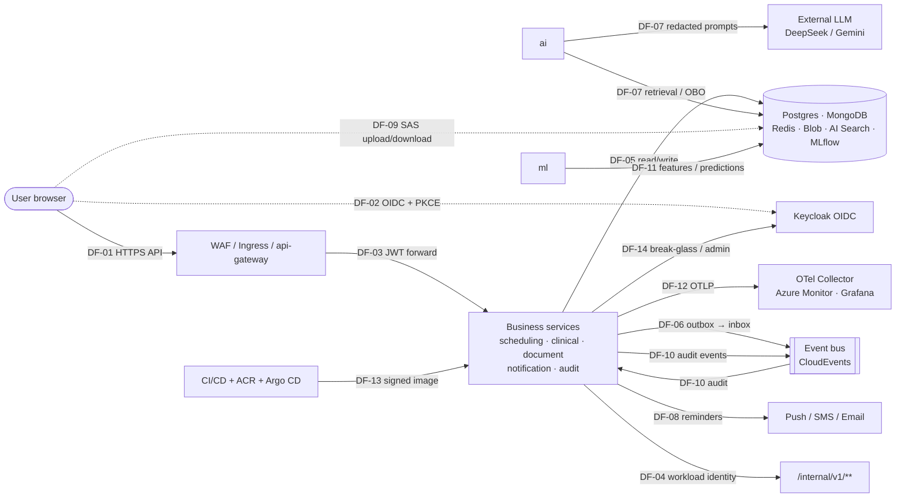

# STRIDE threat model — Smart Hospital Platform

> Task: **ARC-08** (depends on ARC-04). The C4 views this model walks through are in
> [architecture-diagrams.md](architecture-diagrams.md) §1–§4.
>
> Status: **Draft for review.** This is a design-level threat model, not a penetration-test report. It records the
> threats that the current design must resist, the control that resists each one, and the NFR-SEC requirement that
> control implements. It deliberately does **not** claim that every control has been measured: the evidence lives in
> the test catalog and the PRD-06 security review.
>
> The platform processes health data, so the model assumes real patient data even though every environment uses
> synthetic data only (NFR-SEC9). Requirements are taken from
> [non-functional-requirements.md](../02-requirements/non-functional-requirements.md) §4 (NFR-SEC1–SEC9) and from
> the SRS source [60-nfr.yaml](../02-requirements/srs/content/60-nfr.yaml) (NFR-SEC10–SEC21, added in SRS v0.9).
> Test cases are the ones in [security.yaml](../06-testing/catalog/security.yaml) and
> [nfr.yaml](../06-testing/catalog/nfr.yaml).

Contents: [1. Method and scope](#1-method-and-scope) · [2. Data flows](#2-data-flows) ·
[3. Threat tables per flow](#3-threat-tables-per-data-flow) · [4. STRIDE coverage](#4-stride-coverage) ·
[5. Traceability to NFR-SEC](#5-traceability-to-nfr-sec) · [6. Residual risks and gaps](#6-residual-risks-assumptions-and-gaps) ·
[7. Review](#7-review-and-maintenance)

---

## 1. Method and scope

### 1.1 Method

The model uses the C4 container view ([architecture-diagrams.md](architecture-diagrams.md) §2) and the trust zones
in §4. Every arrow that carries data across a boundary becomes a **data flow** (DF-01 … DF-14). For each flow the
table lists the credible **S**poofing, **T**ampering, **R**epudiation, **I**nformation-disclosure, **D**enial-of-service
and **E**levation-of-privilege threats, the control that resists it, and the requirement/test that proves the control.

A mitigation is only listed when it exists in a design document in this repository. Where a threat has no mapped
NFR-SEC item, the row says so instead of inventing one. Section 6 records the gaps this review found.

### 1.2 Scope and shared responsibility

| In scope (this repository) | Out of scope / provider responsibility |
|---|---|
| Browser ↔ edge ↔ gateway ↔ service requests; OIDC login | Physical security, hypervisor, Azure network fabric |
| Service ↔ service `/internal` calls; event bus; data stores | Azure Front Door/WAF engine, Service Bus, Cosmos DB, PostgreSQL engine CVEs |
| Blob SAS upload/download; audit pipeline; AI/LLM egress | The external LLM provider's model integrity and training data |
| Notification provider egress; ML training/serving; telemetry | Upstream security of Keycloak's own dependencies (patched by the team, ADR-0017) |
| CI/CD supply chain; break-glass; admin/DPO operations | Third-party penetration test (recommended before real data, Master Test Plan) |

The local kind cluster is a **development** environment: NetworkPolicy is disabled and Azurite has no WORM
(architecture-diagrams §9). The controls in this model are the UAT/prod controls; local environments contain
synthetic data only (NFR-SEC9).

### 1.3 Assets and classification

| Asset | Classification | Owner | Where it lives |
|---|---|---|---|
| FHIR clinical records (Patient, Encounter, Observation, Condition, AllergyIntolerance) | PHI + identifiers | clinical | MongoDB `clinical` |
| Patient contact data (phone, email, national ID when consented) | PII | clinical | MongoDB `clinical`; the only service that stores contact |
| Clinical documents (PDF/JPEG/PNG) | PHI | document | Blob `documents` + MongoDB `document` metadata |
| Schedules, slots, appointments | PII / operational | scheduling | PostgreSQL `scheduling`; Redis slot cache |
| Audit records | Operational, no clinical content | audit | Blob WORM + Log Analytics `SHPAudit_CL` |
| AI conversations, extraction jobs, knowledge base | PHI-derived | ai | MongoDB `ai` + AI Search + Blob `kb` |
| ML features and predictions | De-identified (IDs + age band) | ml | MongoDB `ml`, Parquet on Blob, MLflow |
| Tokens, client credentials, provider keys | Secret | IdP / Key Vault | Keycloak DB; Key Vault; workload identity |
| Source, images, SBOM, signatures | Supply chain | CI | GitHub, ACR, Argo CD |

### 1.4 Trust boundaries

| Zone | Contains | Crossing control |
|---|---|---|
| Z0 untrusted | Browser | WAF, TLS, rate limiting (cloud); no WAF locally |
| Z1 edge | Front Door/WAF, Envoy Gateway | Only `/`, `/fhir`, `/api` routed; `/internal` has no gateway route |
| Z2 application | web, gateway, business services, `/internal` APIs | Services re-validate the token; label-based NetworkPolicy; workload identity |
| Z3 data | PostgreSQL, MongoDB, Redis, Blob, AI Search, Key Vault, bus | Private endpoints, public access disabled, TLS, managed identity |
| Z4 controlled external | LLM API, push/SMS/email, IdP | Egress only from `ai` and `notification` (uat/prod) |

### 1.5 Rating and priority

Priorities reuse the Master Test Plan definitions instead of introducing a second rubric
([10-test-plan.yaml](../06-testing/content/10-test-plan.yaml), "Testing strategy"):

| Priority | Meaning in this model |
|---|---|
| **P0** | Patient-data disclosure, authorization bypass, audit integrity, AI safety or patient safety. A failing control blocks release. |
| **P1** | Remaining Must functions and the performance/availability NFRs. Fix before the end of the sprint. |
| **P2** | Should/Could functions and secondary UI. May move to a later sprint. |

The threat ID carries the priority, for example `DF-01-T4` **(P0)**.

### 1.6 Reading a threat row

`Trace` uses `NFR-SECn` for the requirement and `TC-…` for a catalog test. `n/a` in the trace column means the design
has no NFR-SEC item for that threat; the control still exists and is named in the mitigation. Section 6 records those
cases as gaps rather than silently assigning a requirement.

---

## 2. Data flows

| Flow | From → to | Data | Boundary crossed | Primary controls |
|---|---|---|---|---|
| DF-01 | Browser → WAF/Ingress → gateway → service | FHIR/API requests and responses, PII/PHI | Z0 → Z1 → Z2 | TLS, WAF, OIDC bearer token, gateway + service validation, rate limits |
| DF-02 | Browser ↔ Keycloak | Credentials, OTP, authorization code, tokens, profile | Z0/Z2 → IdP | PKCE, MFA for staff, short token lifetime, lockout |
| DF-03 | Gateway → business services | Authenticated request, token, PII/PHI | Z1 → Z2 | Re-validation at the service, route allowlist, NetworkPolicy |
| DF-04 | Service ↔ service `/internal/v1/**` | Identity/role/age band, contact data, care check, OBO token | Z2 internal | Workload identity token `aud`/role, per-endpoint allowlist, NetworkPolicy |
| DF-05 | Service ↔ own data store | FHIR documents, metadata, cache entries, outbox/inbox | Z2 → Z3 | Private endpoint, managed identity, encryption at rest, per-service store |
| DF-06 | Service ↔ bus | CloudEvents: IDs, codes, times, statuses, audit records | Z2 → Z3 | Outbox/inbox, schema validation, TLS, broker identity |
| DF-07 | ai ↔ external LLM and ai ↔ AI Search/MongoDB/clinical | Redacted prompts, retrieved chunks, answers, OBO requests | Z2 → Z4 and Z2 → Z3 | Mandatory PII redaction, egress only `ai`, security trimming, OBO |
| DF-08 | notification → push/SMS/email | Reminder text, phone/email, delivery status | Z2 → Z4 | Minimal content, egress only `notification`, retry/DLQ |
| DF-09 | Browser ↔ Blob direct | Documents and object paths | Z0 → Z3 | User-delegation SAS: one blob, one permission, short TTL |
| DF-10 | Services → audit → WORM Blob + Log Analytics | Audit records, trace IDs, masked IP | Z2 → Z3 | Append-only, WORM, hash chain, DPO/Admin-only read |
| DF-11 | ml ↔ event bus, Mongo, Blob Parquet, MLflow | De-identified features, predictions, model artifacts | Z2 → Z3 | IDs/age band only, synthetic training data, registry aliases |
| DF-12 | Services → OTel Collector → observability | Traces, metrics, structured logs | Z2 → observability | PII filtering, internal OTLP, log scans |
| DF-13 | GitHub Actions → ACR → Argo CD → AKS | Source, dependencies, images, SBOM, manifests | CI → Z2 | Scan, sign, SBOM, digest pinning, Kyverno, GitOps |
| DF-14 | Doctor/Admin/DPO → privileged operations | Break-glass session, role assignment, audit export | Z2 → Z3 | Matrix, 60-minute scope, DPO alert, second-person approval |

---

## 3. Threat tables per data flow

### DF-01 — User browser ↔ edge and gateway

Authenticated API traffic: slot search, booking, records, documents, AI assistant. This is the largest attack surface
and the only path an external user has to the application.

| ID | STRIDE | Threat | Impact | Mitigation (where) | Trace |
|---|---|---|---|---|---|
| DF-01-T1 (P0) | Spoofing | A stolen or replayed bearer token is used from another device or by another person | Read/write patient data as the victim | Authorization Code + PKCE, access token ≤ 15 minutes kept in memory, staff MFA (`amr`), signature/`iss`/`aud`/`exp` checked at the gateway **and** the service (15-authorization §1; 07-api-conventions §2) | NFR-SEC1, NFR-SEC14; TC-SEC-04, TC-SEC-06, TC-SEC-28 |
| DF-01-T2 (P1) | Tampering | A man-in-the-middle changes a request or response, or TLS is downgraded | Altered appointment or clinical data; leaked response | TLS 1.2+ at the edge and inside the cluster; HSTS, strict CSP; WAF OWASP rule set (architecture-diagrams §4; NFR-SEC15) | NFR-SEC3, NFR-SEC15; TC-SEC-09, TC-SEC-22 |
| DF-01-T3 (P0) | Repudiation | A patient or staff member denies booking, cancelling or viewing a record | No accountability; a privacy incident cannot be reconstructed | Every allow **and** deny emits `shp.audit.recorded.v1` with subject, action, purpose and `traceId` (05-storage-audit-blob §1.1); immutable WORM original | NFR-SEC5; TC-SEC-26 |
| DF-01-T4 (P0) | Information disclosure | IDOR: a patient or doctor reads another patient's record, appointment or document by changing an ID | PHI disclosure | Matrix + object-level `own`/`care`/`breakglass`; another person's resource returns **404**, not 403; `patient` filter forced at the query layer (15-authorization §6) | NFR-SEC2, NFR-SEC13; TC-SEC-01, TC-SEC-02, TC-SEC-16 |
| DF-01-T5 (P0) | Information disclosure | Stored XSS steals a token or renders PHI; a verbose error leaks table names or stack traces | Session hijack, data leak, useful reconnaissance | Strict CSP, token never in `localStorage`, in-memory only; output encoding; standard Problem Details/OperationOutcome without internals (07-api-conventions §5) | NFR-SEC13, NFR-SEC14, NFR-SEC15; TC-SEC-08, TC-SEC-09, TC-SEC-12, TC-SEC-27 |
| DF-01-T6 (P1) | Denial of service | A flood or a scraper exhausts the gateway or enumerates patients | Booking outage; bulk patient discovery | WAF + per-`sub` rate limits (default 120/min, booking 10/min, patient search 60/min, AI 20/min, registration 5/hour/IP), waiting room with 429, minimum search conditions (07-api-conventions §6; 15-authorization §6) | NFR-SEC16, NFR-S3; TC-SEC-15 |
| DF-01-T7 (P0) | Elevation of privilege | A patient calls a staff/admin endpoint, or a hidden menu is treated as a permission | Privilege escalation | Menus are navigation only; every endpoint has `@RequireShpAuthz`; the matrix is deny-by-default and tested per cell; missing rule fails CI (15-authorization §1–§3) | NFR-SEC2; TC-SEC-02, TC-SEC-03 |
| DF-01-T8 (P1) | Information disclosure | On a shared clinic machine, patient data remains visible after logout or with the Back button | PHI disclosed to the next user | Logout clears the SPA state; no token or patient data in `localStorage`/`sessionStorage`; idle logout (staff 15 min, patient 30 min) | NFR-SEC14; TC-SEC-27, TC-SEC-28 |

### DF-02 — User browser ↔ Keycloak (OIDC and registration)

Identity is the root of every authorization decision. Keycloak is operated by the team in every environment
(ADR-0017), so its compromise is equivalent to compromise of the platform.

| ID | STRIDE | Threat | Impact | Mitigation (where) | Trace |
|---|---|---|---|---|---|
| DF-02-T1 (P0) | Spoofing | Credential stuffing or brute force against a patient or staff account | Account takeover | Temporary lock after 5 failures and IP blocking; patient passwords ≥ 12 characters and checked against breached lists; staff MFA (TOTP/WebAuthn, not SMS); Argon2id hashes only in Keycloak (ADR-0017) | NFR-SEC1, NFR-SEC16; TC-SEC-06, TC-SEC-15 |
| DF-02-T2 (P0) | Spoofing | Phishing or a look-alike login page captures credentials or tokens | Account takeover | Login served on the hospital's own domain at `/idp` through the gateway, HTTPS only, no CORS; PKCE; users are not redirected to a third-party tenant (ADR-0017; architecture-diagrams §5) | NFR-SEC1, NFR-SEC15; TC-SEC-09 |
| DF-02-T3 (P0) | Tampering | Authorization-code interception or substitution | Attacker exchanges the code for a token | Authorization Code + PKCE (`code_verifier`); access token ≤ 15 minutes; `aud` checked by every service | NFR-SEC1; TC-SEC-04 |
| DF-02-T4 (P0) | Information disclosure | A token is written to browser storage or leaked by an XSS payload | Token theft | The SPA keeps the token in memory; `localStorage` must contain no token; strict CSP (architecture-diagrams §5; NFR-SEC14) | NFR-SEC14, NFR-SEC15; TC-SEC-28, TC-SEC-08 |
| DF-02-T5 (P1) | Information disclosure | OTP brute force or phone-number enumeration during registration/claim | Account or record takeover | OTP limits: 5 codes per hour per number, 20 per hour per IP, 5 requests per 24 hours per account; identical response whether or not a record exists (11-api-notification-audit-ml §N8; 09-api-clinical C24/C27) | NFR-SEC16, NFR-SEC13; TC-SEC-15 |
| DF-02-T6 (P0) | Elevation of privilege | Self-registration or a manipulated claim grants a staff role | Unauthorized clinical access | New accounts get role `patient`; staff accounts are invited by an Admin; `identity_links` checks `PractitionerRole.code`; roles come only from the signed claim (15-authorization §8) | NFR-SEC1, NFR-SEC2; TC-SEC-05 |
| DF-02-T7 (P1) | Denial of service | Keycloak is unavailable, so no user can sign in | Platform unusable | Two replicas in prod, dedicated PostgreSQL, backups and restore testing, digest-pinned scanned image (ADR-0017). The docs do not set a separate IdP availability SLO; see gap G6 | n/a (no NFR-SEC item); NFR-A1 is the closest availability target |
| DF-02-T8 (P1) | Repudiation | A login or account change cannot be attributed | Weak incident reconstruction | The audit action enum includes `login`; account changes are performed through audited Admin APIs; Keycloak's own event log should be retained (not specified in this repo, gap G6) | NFR-SEC5 |

### DF-03 — Gateway → business services (north-south)

The gateway is an enforcement point, not a trust anchor: the services re-check the token and make the business
decision.

| ID | STRIDE | Threat | Impact | Mitigation (where) | Trace |
|---|---|---|---|---|---|
| DF-03-T1 (P0) | Spoofing | A caller bypasses the gateway or forges headers that the service trusts | Unauthenticated access | Services verify the token themselves and do not trust gateway-added headers; `/internal` has no gateway route; NetworkPolicy default-deny (15-authorization §1; architecture-diagrams §4) | NFR-SEC1, NFR-SEC7; TC-SEC-20 |
| DF-03-T2 (P0) | Elevation of privilege | A new endpoint is added without an authorization rule | Silent privilege escalation | `@RequireShpAuthz` on every endpoint; a test fails if an endpoint has no matrix rule; deny-by-default (15-authorization §3) | NFR-SEC2; TC-SEC-02 |
| DF-03-T3 (P1) | Information disclosure | The gateway logs full URLs, bodies or error details containing PII/PHI | PII in observability stores | Structured logs with `traceId` and no PII; standard errors; OTel collector PII filtering (00-conventions §3; architecture-diagrams §6.1) | NFR-SEC13, NFR-O4; TC-SEC-11, TC-SEC-12 |
| DF-03-T4 (P1) | Tampering | Malformed traffic or a framework request-smuggling flaw reaches a service | Request interpreted differently by two layers | WAF OWASP rules; Spring Cloud Gateway route allowlist; schema validation; 10-second gateway timeout (07-api-conventions §7); framework CVEs handled by the image scan | NFR-SEC15, NFR-SEC6; TC-SEC-07, TC-SEC-10, TC-SEC-24 |
| DF-03-T5 (P1) | Denial of service | A burst at the gateway saturates a single service | Partial or full outage | Per-user rate limits, waiting room/429, HPA and KEDA; independent scaling (07-api-conventions §6; NFR-S3/S4) | NFR-SEC16, NFR-S3; TC-SEC-15 |
| DF-03-T6 (P1) | Elevation of privilege | A request is routed to a service that should not receive it | A service sees data outside its remit | Explicit route table, one namespace per environment, per-service NetworkPolicy; services never accept a caller-supplied role (07-api-conventions §1) | NFR-SEC7, NFR-SEC2; TC-SEC-21 |

### DF-04 — Service ↔ service `/internal/v1/**`

Internal calls carry identity, role and age band (scheduling → clinical), contact data (notification → clinical),
the care-relationship check (document → clinical) and on-behalf-of user calls (ai → clinical/scheduling).

| ID | STRIDE | Threat | Impact | Mitigation (where) | Trace |
|---|---|---|---|---|---|
| DF-04-T1 (P0) | Spoofing | A pod outside the declared set, or a caller from outside the cluster, calls `/internal` | Impersonation of a trusted service | Workload-identity token (`aud` = target, app role `internal.<service>`), a per-endpoint allowlist, NetworkPolicy by pod label, and no `/internal` route at the gateway (07-api-conventions §8; 15-authorization §7) | NFR-SEC7, NFR-SEC1; TC-SEC-20 |
| DF-04-T2 (P0) | Elevation of privilege | A compromised service uses its internal role to read data beyond its declared purpose | Cross-service data access | Least-privilege per endpoint; `/internal` uses a workload token, never a user token; the gateway cannot reach it; NetworkPolicy limits which labels may connect (15-authorization §7) | NFR-SEC7, NFR-SEC2; TC-SEC-20, TC-SEC-21 |
| DF-04-T3 (P1) | Information disclosure | An internal endpoint returns more PII than the caller needs | Unnecessary PII propagation | Clinical is the only service that stores phone/email and exposes one contact endpoint; identity lookup returns identity/role, not clinical content; responses are shaped per use case (architecture-diagrams §6.1; 09-api-clinical §4) | NFR-SEC10, NFR-SEC13; TC-SEC-16 |
| DF-04-T4 (P1) | Repudiation | An internal read of sensitive data is not attributed | An access cannot be investigated | Every sensitive internal read writes an audit record; background jobs use `actor.role=system` and `purposeOfUse=HOPERAT` (05-storage-audit-blob §1.1; 15-authorization §7) | NFR-SEC5; TC-SEC-26 |
| DF-04-T5 (P1) | Tampering | An internal response is modified in transit | A wrong care relationship or identity is trusted | TLS inside the cluster (NFR-SEC3) plus NetworkPolicy; the caller validates the response schema | NFR-SEC3, NFR-SEC7; TC-SEC-22 |
| DF-04-T6 (P2) | Denial of service | A slow or failing internal dependency cascades into the caller | Booking or document flow stalls | Internal calls have a timeout; retry only where the operation is idempotent; failure degrades to a defined error (overview §2.2) | NFR-A6, NFR-P1; no NFR-SEC item |

### DF-05 — Service ↔ its own data store

Each service writes only its own store: PostgreSQL for scheduling/notification/ml, MongoDB for
clinical/document/audit-inbox/ai/ml, Redis for the slot cache, Blob for documents/audit/Parquet, AI Search for the
knowledge base, MLflow for models (ADR-0008, ADR-0014).

| ID | STRIDE | Threat | Impact | Mitigation (where) | Trace |
|---|---|---|---|---|---|
| DF-05-T1 (P0) | Spoofing | A stolen database password or storage key is used directly | Full data-store compromise | Azure: password auth disabled, managed identity + Workload Identity, Blob shared key disabled, secrets only in Key Vault (02-db-scheduling §5; 05-storage-audit-blob §2); local: dev-only credentials | NFR-SEC4, NFR-SEC7; TC-SEC-23, TC-SEC-21 |
| DF-05-T2 (P0) | Tampering | A direct write bypasses the application invariants (double booking, state machine) | Corrupt appointments or clinical state | The service is the only writer; DB constraints and unique indexes enforce invariants (ADR-0005); private endpoint, no public access | n/a (integrity); ADR-0005, NFR-SEC7; TC-SEC-21 |
| DF-05-T3 (P0) | Information disclosure | A snapshot, backup or replica exposes data at rest | PHI disclosure | Encryption at rest for every store and backup; private endpoint; GZRS in prod; versioning + soft delete on documents; WORM for audit (architecture-diagrams §6; 05-storage-audit-blob §1.2) | NFR-SEC3, NFR-SEC7; TC-SEC-21, TC-SEC-22 |
| DF-05-T4 (P1) | Information disclosure | Patient data is cached or logged where it is not expected | PII in Redis or logs | Redis caches free-slot data, not patient PII; logs and traces are PII-free and scanned (architecture-diagrams §6.1; 00-conventions §3) | NFR-SEC13, NFR-O4; TC-SEC-11 |
| DF-05-T5 (P0) | Elevation of privilege | One service reads another service's database | Cross-service access to PHI | Database per service, separate identities, no cross-service joins; references are FHIR `Reference` IDs only; NetworkPolicy (ADR-0008; overview §6) | NFR-SEC7; TC-SEC-21 |
| DF-05-T6 (P1) | Denial of service | A store outage or corruption loses committed data | Data loss / unavailability | PITR, geo-redundant backup in prod, zone-redundant storage, restore drills (02-db-scheduling §5; NFR-A4/A5) | n/a (availability); NFR-A4, NFR-A5 |
| DF-05-T7 (P2) | Repudiation | A database operator changes data without an application audit record | An insider change is invisible | Application audit covers API access, not operator access; DB-engine auditing is not specified in this repo (gap G8) | n/a |

### DF-06 — Event bus (outbox → bus → inbox)

Events are the integration mechanism. They carry no PII by contract, but a forged event can still change a
consumer's state.

| ID | STRIDE | Threat | Impact | Mitigation (where) | Trace |
|---|---|---|---|---|---|
| DF-06-T1 (P0) | Spoofing | An attacker publishes an event that looks like it came from a service | Forged booking, merge or audit data | Broker identity via workload identity/Key Vault; the bus is in Z3 with no public endpoint; consumers subscribe only to the types they own (13-events §1.1) | NFR-SEC4, NFR-SEC7; TC-SEC-23, TC-SEC-21 |
| DF-06-T2 (P1) | Tampering | An event is modified, replayed or processed twice | Duplicate reminders, double state changes | CloudEvents schema validation at publish and consume; `id` (UUIDv7) recorded in the inbox for exactly-once processing; outbox event and data in the same transaction; `version` skips stale events (13-events §1) | n/a for integrity; ADR-0005 and 13-events are the source |
| DF-06-T3 (P0) | Information disclosure | PII/PHI is put into an event payload | Data leaves the owning service and lands in the bus and consumers | Contract: events contain only IDs, codes, times and statuses; JSON Schema plus the PII scan test enforce it (13-events §1; NFR-SEC13) | NFR-SEC13; TC-SEC-11 |
| DF-06-T4 (P1) | Denial of service | A poison event crashes a consumer, or the DLQ grows unnoticed | Reminders/audit stop; backlog grows | `PoisonEventException` after 5 attempts → DLQ; alert when the DLQ is non-empty; replay tooling; log only `id`, `type` and the failing field (13-events §1.1) | NFR-A6, NFR-O3 |
| DF-06-T5 (P1) | Elevation of privilege | A consumer acts on events outside its responsibility | A service modifies data it does not own | Consumers only update their own store; sensitive reads go through the audited internal API; subscriptions are per service (13-events §1; 15-authorization §7) | NFR-SEC2, NFR-SEC7; TC-SEC-20 |
| DF-06-T6 (P1) | Repudiation | An event is silently lost, so the audit trail has a hole | An access or state change is unaccounted for | Outbox is written in the same transaction as the data; relay retries; inbox deduplicates; audit events use the same path (05-storage-audit-blob §1.2; 13-events §1) | NFR-SEC5; TC-SEC-26 |

### DF-07 — AI service ↔ external LLM and retrieval

The `ai` service is the only application component allowed to open egress to an LLM provider (ADR-0013). It reads
patient data on behalf of the caller through RFC 8693 token exchange and must redact identifiers before any external
call.

| ID | STRIDE | Threat | Impact | Mitigation (where) | Trace |
|---|---|---|---|---|---|
| DF-07-T1 (P0) | Information disclosure | PII/PHI is sent to DeepSeek or Gemini without redaction | Cross-border disclosure of health data | Every external chain entry has `redactPii: true` and there is no off switch; Ollama in the cluster is the last fallback; only `ai` has egress (06-data-ai §"LLM router"; architecture-diagrams §6.1) | NFR-SEC8, NFR-SEC21; TC-SEC-18 |
| DF-07-T2 (P0) | Tampering | Prompt injection in a question or in a knowledge-base document changes the answer or triggers a tool | Unsafe clinical advice, tool misuse, prompt disclosure | Input validation, security trimming, output schema validation, the ≥ 50-sample attack suite, a tool allowlist, and human confirmation before any write (06-data-ai; 15-authorization §7) | NFR-SEC8, NFR-AI3; TC-SEC-17 |
| DF-07-T3 (P0) | Elevation of privilege | AI uses its own broad credentials or a tool to read data the caller cannot see | Data disclosure through the assistant | RFC 8693 token exchange: AI carries the user's identity to clinical/scheduling and has no separate read permission; tools are limited to the declared list; writes need confirmation (15-authorization §7) | NFR-SEC8, NFR-SEC2; TC-SEC-19 |
| DF-07-T4 (P0) | Information disclosure | Retrieval returns a chunk the caller is not allowed to see | PHI in an answer/citation | `allowedRoles` security trimming is applied **inside** the AI Search query, not after retrieval; care relationship and patient scope are re-checked by the owning service (06-data-ai §"Index") | NFR-SEC2, NFR-SEC8; TC-SEC-19 |
| DF-07-T5 (P1) | Tampering | A poisoned knowledge-base document is ingested and retrieved | Misleading answers with a valid citation | Knowledge base is managed by Admin only (access matrix); ingestion uses versioned originals and the document malware scan; prompt-injection tests cover documents (06-data-ai; 05-storage-audit-blob §2) | NFR-SEC2, NFR-SEC17, NFR-SEC8; TC-SEC-13, TC-SEC-17 |
| DF-07-T6 (P1) | Repudiation | An AI query or AI-initiated action cannot be attributed | An AI action is unattributable | Every call writes an `ai-query` audit record with model, tokens and cost but **not** the question content; writes run as the confirmed user (05-storage-audit-blob §1.1; architecture-diagrams §11.1) | NFR-SEC5; TC-SEC-26 |
| DF-07-T7 (P1) | Denial of service | The provider times out, rate-limits or returns invalid output | AI feature unavailable | Fallback chain DeepSeek → Gemini → Ollama → retrieval-only; per-model circuit breaker; daily token quota (ADR-0013; 06-data-ai) | NFR-A2, NFR-C2 |
| DF-07-T8 (P1) | Information disclosure | The answer leaks the system prompt or presents a hallucination as clinical advice | Unsafe or misleading output | Output validation, groundedness/citation thresholds, correct-refusal target, and the rule that AI does not diagnose or prescribe (BR-09) | NFR-AI2, NFR-SEC8; TC-SEC-17 |

### DF-08 — Notification service → push / SMS / email

`notification` is the only service allowed to call messaging providers. The content must be useful without
disclosing clinical details.

| ID | STRIDE | Threat | Impact | Mitigation (where) | Trace |
|---|---|---|---|---|---|
| DF-08-T1 (P1) | Information disclosure | A reminder contains a diagnosis or is sent to the wrong phone/email | PHI/PII disclosure to a third party | Minimal content with no diagnosis; contact data comes from clinical's single internal endpoint; language/preferences per patient; the wrong-recipient path is tested | NFR-SEC10, NFR-SEC13; TC-SEC-16 |
| DF-08-T2 (P1) | Spoofing | A leaked provider credential or spoofed provider endpoint is used | Messages sent as the hospital, or credentials abused | Provider secrets in Key Vault; TLS to the provider; only `notification` has egress (NFR-SEC4; architecture-diagrams §4) | NFR-SEC4, NFR-SEC7; TC-SEC-23 |
| DF-08-T3 (P0) | Elevation of privilege | Patient A receives patient B's reminder or a link to B's document | Direct PHI disclosure | Reminder is built from event IDs and a `patientId` lookup; per-appointment deduplication; no patient PII in the event (13-events §1; 04-db-notification-ml §1) | NFR-SEC2, NFR-SEC5; access matrix |
| DF-08-T4 (P2) | Tampering | A message body is altered or the sender identity is spoofed in transit | Misleading message; phishing appearance | Provider TLS; sender registration/anti-spoofing is a provider configuration not specified in this repo (gap G10) | NFR-SEC3; TC-SEC-22 |
| DF-08-T5 (P1) | Denial of service | The provider is down, so reminders are lost | Missed appointments; NFR-P8 missed | Retry with backoff, DLQ, fallback channel, and a delivery-attempt record (04-db-notification-ml §1; NFR-A6) | NFR-A6, NFR-P8 |
| DF-08-T6 (P2) | Repudiation | A delivery dispute cannot be resolved | Operational/legal uncertainty | `delivery_attempt` rows and audit records record what was sent and when (04-db-notification-ml §1) | NFR-SEC5 |
| DF-08-T7 (P1) | Information disclosure | Phone numbers or message content appear in logs | PII in observability stores | PII-free structured logs and log scans (00-conventions §3; NFR-SEC13) | NFR-SEC13, NFR-O4; TC-SEC-11 |

### DF-09 — Browser ↔ Blob (direct SAS upload/download)

Documents do not pass through the API. The browser receives a user-delegation SAS for exactly one blob and talks to
Blob directly.

| ID | STRIDE | Threat | Impact | Mitigation (where) | Trace |
|---|---|---|---|---|---|
| DF-09-T1 (P0) | Spoofing | A leaked or replayed SAS link is used by another person | Document disclosure or replacement | User-delegation SAS: one blob, one permission, `Content-Type` restriction, 5 minutes read / 10 minutes write; expiry returns 403 (05-storage-audit-blob §2; BR-08) | NFR-SEC2, NFR-SEC5; TC-SEC-14 |
| DF-09-T2 (P0) | Elevation of privilege | A patient obtains a SAS for another patient's blob | PHI disclosure | Ownership/care/released checks run **before** issuing the SAS; every issuance writes a `download-url` audit record; the FHIR resource stores no `url` (05-storage-audit-blob §2; 01-domain-model §4.10) | NFR-SEC2, NFR-SEC5; TC-SEC-01, TC-SEC-14 |
| DF-09-T3 (P0) | Tampering | A renamed extension, polyglot, oversized file or `../` file name is uploaded | Malware execution or path traversal | Content-based type check, ≤ 20 MB, malware scan (Defender/ClamAV), quarantine container, system-generated object names (05-storage-audit-blob §2) | NFR-SEC17; TC-SEC-13 |
| DF-09-T4 (P1) | Information disclosure | A blob container is public or enumerable | Mass document disclosure | Private containers, shared key disabled, private endpoint, no public blob access, SAS only (05-storage-audit-blob §2; architecture-diagrams §4) | NFR-SEC7, NFR-SEC3; TC-SEC-21 |
| DF-09-T5 (P1) | Denial of service | Upload abuse exhausts storage or the scan queue | Document flow unavailable; cost overrun | 20 MB limit, gateway rate limits, lifecycle to Cool/Cold, quotas (05-storage-audit-blob §2; 07-api-conventions §6) | NFR-SEC16, NFR-C1; TC-SEC-15 |
| DF-09-T6 (P2) | Repudiation | An upload or download cannot be attributed | A document leak cannot be investigated | `upload_sessions`, SHA-1 content hash, and the audited `download-url` action (05-storage-audit-blob §2; 01-domain-model §4.10) | NFR-SEC5 |
| DF-09-T7 (P0) | Tampering | A quarantined (infected) file is later served | Malware delivered to a user | No `document-uploaded` event until the scan is clean; only the Security Admin can read the quarantine container (05-storage-audit-blob §2; 01-domain-model §5) | NFR-SEC17; TC-SEC-13 |

### DF-10 — Services → audit service → WORM Blob and Log Analytics

The audit path is itself a target: an attacker who can suppress or alter it defeats every other control's
accountability.

| ID | STRIDE | Threat | Impact | Mitigation (where) | Trace |
|---|---|---|---|---|---|
| DF-10-T1 (P0) | Tampering | An audit record is modified or deleted | Loss of evidence; a breach is hidden | Time-based immutability (prod: locked, 10 years); only the audit service has `Storage Blob Data Contributor`; nobody has delete permission during the lock; an SHA-256 hash chain plus `audit-verify` detects a break (05-storage-audit-blob §1.2) | NFR-SEC5; TC-SEC-26 |
| DF-10-T2 (P0) | Spoofing | A forged audit record is injected | A false trail, or a false denial of an action | Records arrive as internal CloudEvents from authenticated services; schema validation; audit is the only consumer (13-events §1.1) | NFR-SEC1, NFR-SEC5, NFR-SEC7; TC-SEC-20 |
| DF-10-T3 (P0) | Repudiation | An access happens but no audit record is written | 100% audit coverage is broken | The common library emits `audit-recorded` for every allow **and** deny; integration tests correlate operations with audit entries; the record schema is fixed (05-storage-audit-blob §1.1) | NFR-SEC5; TC-SEC-26 |
| DF-10-T4 (P1) | Information disclosure | The audit store contains clinical content or unmasked identifiers | A second copy of PHI with different access rules | The schema contains no clinical content; search records only the parameter **name**, not the value; client IP is masked (05-storage-audit-blob §1.1) | NFR-SEC5, NFR-SEC13; TC-SEC-11 |
| DF-10-T5 (P0) | Elevation of privilege | Admin or an attacker reads/export the audit store, or Admin sees the break-glass reason | Unauthorized access to access history | Only DPO and Admin may read; Admin does not see the break-glass `reason`; Admin/DPO cannot read clinical data (access matrix; 15-authorization §3) | NFR-SEC2, NFR-SEC18; TC-NFR-SEC18 |
| DF-10-T6 (P1) | Denial of service | The audit pipeline is down long enough that evidence is delayed or lost | NFR-SEC5's "searchable within 1 minute" is missed; a breach window is unrecorded | Outbox retries, DLQ alert, audit service buffering, WORM original; Log Analytics is the query copy, not the original (05-storage-audit-blob §1.2–§1.3) | NFR-SEC5, NFR-A6, NFR-O3; TC-SEC-26 |

### DF-11 — ML pipeline (events, feature store, predictions, MLflow)

The no-show model is deliberately decoupled from the clinical flow: it consumes events and publishes a score, so
an ML failure cannot block booking or reminders (ADR-0007).

| ID | STRIDE | Threat | Impact | Mitigation (where) | Trace |
|---|---|---|---|---|---|
| DF-11-T1 (P0) | Information disclosure | The training set, feature store or report contains direct identifiers | Re-identification of patients | Only IDs and a 10-year `ageBand`; training data is entirely synthetic; reports are de-identified (04-db-notification-ml §2.1; 16-mlops §1) | NFR-SEC20, NFR-SEC9; TC-NFR-SEC20 |
| DF-11-T2 (P1) | Tampering | A model artifact or training image is replaced | Wrong scores or a malicious serving process | MLflow registry aliases (`candidate` → `production`), quality gates, model card, digest-pinned scanned training image (16-mlops §2–§3). Artifact signing is not specified — gap G4 | NFR-SEC6, NFR-AI6; TC-SEC-24 |
| DF-11-T3 (P1) | Spoofing | A forged `no-show-scored` event changes reminders | A patient receives the wrong reminder policy | Event arrives on the internal bus from `ml`; schema validation; broker identity (13-events §1) | NFR-SEC7, NFR-SEC1; TC-SEC-21 |
| DF-11-T4 (P1) | Elevation of privilege | The model uses attributes it should not, or performs worse for a subgroup | Unfair or unsafe prioritization | The feature list is fixed and documented; subgroup AUC is a registration gate; no direct identifiers (04-db-notification-ml §2.3; 16-mlops §3) | NFR-SEC20, NFR-AI6; TC-NFR-SEC20 |
| DF-11-T5 (P1) | Denial of service | ML is unavailable or slow | No risk score; notification falls back | Event-driven decoupling: notification does not call ML synchronously; a missing score means the default reminder (ADR-0007; NFR-A2/A6) | NFR-A2, NFR-A6 |
| DF-11-T6 (P2) | Repudiation | A prediction cannot be traced to a model version | An outcome cannot be audited | `predictions` stores `modelName`, `modelVersion`, features and `predictedAt`; MLflow records dataset hash and git SHA (04-db-notification-ml §2.2; 16-mlops §2) | NFR-SEC5, NFR-AI7 |

### DF-12 — Services → OTel Collector → observability backends

Telemetry is a copy of activity and can leak data if it is not filtered.

| ID | STRIDE | Threat | Impact | Mitigation (where) | Trace |
|---|---|---|---|---|---|
| DF-12-T1 (P0) | Information disclosure | Logs, traces or metrics contain names, phone numbers or clinical values | PHI in Azure Monitor/Grafana/Loki | Structured logs with `traceId` and no PII; the collector filters PII; a log-scan test uses recognizable synthetic values (architecture-diagrams §10; TC-SEC-11) | NFR-SEC13, NFR-O4; TC-SEC-11 |
| DF-12-T2 (P2) | Spoofing | Forged telemetry is injected into the collector | Misleading alerts or dashboards | The OTLP endpoint is internal to the cluster and NetworkPolicy-restricted (architecture-diagrams §4, §10) | NFR-SEC7; TC-SEC-21 |
| DF-12-T3 (P1) | Tampering | The Log Analytics copy of the audit trail is altered | A false audit view | The Blob WORM original plus hash chain is authoritative; Log Analytics is only a query copy (05-storage-audit-blob §1.2–§1.3) | NFR-SEC5; TC-SEC-26 |
| DF-12-T4 (P2) | Denial of service | A telemetry flood overloads the collector or the backend | Loss of observability during an incident | Sampling, resource limits and collector isolation (architecture-diagrams §10); the docs do not set a telemetry SLO | NFR-S3 |

### DF-13 — CI/CD supply chain (GitHub Actions → ACR → Argo CD → AKS)

Images and manifests are the only way code reaches the cluster; compromise of this flow bypasses every runtime
control.

| ID | STRIDE | Threat | Impact | Mitigation (where) | Trace |
|---|---|---|---|---|---|
| DF-13-T1 (P0) | Spoofing | A compromised dependency or a look-alike image is built into a release | Backdoored service with full data access | Pinned versions; Trivy/OSV/Dependency-Check; cosign keyless signature; SBOM; Kyverno `shp-restrict-registry`, `shp-verify-signature`, `shp-disallow-latest` (architecture-diagrams §3; ADR-0009) | NFR-SEC6; TC-SEC-24 |
| DF-13-T2 (P1) | Tampering | A build artifact is replaced between build and deploy | A different image runs than was reviewed | Image digest pinning, ACR, signature check at admission, GitOps commit as the deploy record (architecture-diagrams §8) | NFR-SEC6, NFR-SEC4; TC-SEC-24 |
| DF-13-T3 (P0) | Information disclosure | A secret or connection string is committed or baked into an image | Credential compromise | gitleaks + push protection, no secrets in code/config/images, Key Vault + Workload Identity (NFR-SEC4; architecture-diagrams §8) | NFR-SEC4; TC-SEC-23 |
| DF-13-T4 (P0) | Elevation of privilege | A workflow or PR obtains cloud credentials beyond its environment | Infrastructure takeover | GitHub OIDC federated identity per environment, no stored client secret, environment approval gates, least-privilege token permissions, CODEOWNERS (architecture-diagrams §8.3) | NFR-SEC4, NFR-SEC7, NFR-D4; TC-SEC-23 |
| DF-13-T5 (P1) | Repudiation | An unattributed change reaches the cluster | No answer to "who deployed this" | Argo CD is the only path; Git history + signed image + environment approvals (architecture-diagrams §8.2) | NFR-SEC6, NFR-D2; TC-SEC-24 |
| DF-13-T6 (P2) | Denial of service | The runner, registry or Argo CD is unavailable | Deployments stop; rollback delayed | Pinned reusable workflows and ACR; the docs do not specify a CI/registry failover (gap G12) | NFR-D2 |

### DF-14 — Privileged operations: break-glass, role assignment and audit export

These are the operations that can override the normal authorization model, so they need the strongest
accountability.

| ID | STRIDE | Threat | Impact | Mitigation (where) | Trace |
|---|---|---|---|---|---|
| DF-14-T1 (P0) | Elevation of privilege | A doctor uses break-glass without a real emergency, or keeps using it after 60 minutes | Unjustified PHI access | Reason of 20–500 characters; 60-minute TTL, one patient, read-only; no extension; every read audited with `purposeOfUse=ETREAT`; DPO notified within ≤ 5 minutes (15-authorization §5) | NFR-SEC2, NFR-SEC5, NFR-SEC18; TC-SEC-25 |
| DF-14-T2 (P1) | Repudiation | An emergency access cannot be attributed or reviewed | A privacy incident is unprovable | Audit record carries actor, patient, reason, purpose and trace; the DPO marks it justified/unjustified (15-authorization §5; 05-storage-audit-blob §1.1) | NFR-SEC5; TC-SEC-25, TC-SEC-26 |
| DF-14-T3 (P0) | Information disclosure | A DPO or Admin sees clinical content while reviewing audit or managing users | Unauthorized clinical access | Admin/DPO cannot read clinical data; Admin sees audit without the break-glass reason; only DPO has the full audit view (access matrix; 15-authorization §3) | NFR-SEC2, NFR-SEC18; TC-NFR-SEC18 |
| DF-14-T4 (P0) | Elevation of privilege | An Admin grants a privileged role or restores data without a second person | Insider privilege escalation or data resurrection | NFR-SEC18 requires a second approver for privileged role assignment and restore; the matrix denies clinical access to Admin | NFR-SEC18; TC-NFR-SEC18 |
| DF-14-T5 (P0) | Spoofing | An Admin or DPO account is compromised | Broad administrative capability | MFA (TOTP/WebAuthn), short tokens, lockout after 5 failures, session timeout, audit of every action | NFR-SEC1, NFR-SEC14, NFR-SEC16; TC-SEC-06, TC-SEC-15, TC-SEC-28 |
| DF-14-T6 (P1) | Information disclosure | A DPO exports the whole audit store in bulk | Mass metadata disclosure | Export is an audited action; the audit store contains no clinical content; bulk-export limits are not specified (gap G13) | NFR-SEC5, NFR-SEC13; TC-SEC-11 |

---

## 4. STRIDE coverage

Each cell names the threat IDs in that flow; `–` means the category has no credible threat on that flow.

| Flow | S | T | R | I | D | E |
|---|---|---|---|---|---|---|
| DF-01 | T1 | T2 | T3 | T4, T5, T8 | T6 | T7 |
| DF-02 | T1, T2 | T3 | T8 | T4, T5 | T7 | T6 |
| DF-03 | T1 | T4 | – | T3 | T5 | T2, T6 |
| DF-04 | T1 | T5 | T4 | T3 | T6 | T2 |
| DF-05 | T1 | T2 | T7 | T3, T4 | T6 | T5 |
| DF-06 | T1 | T2 | T6 | T3 | T4 | T5 |
| DF-07 | – | T2, T5 | T6 | T1, T4, T8 | T7 | T3 |
| DF-08 | T2 | T4 | T6 | T1, T7 | T5 | T3 |
| DF-09 | T1 | T3, T7 | T6 | T4 | T5 | T2 |
| DF-10 | T2 | T1 | T3 | T4 | T6 | T5 |
| DF-11 | T3 | T2 | T6 | T1 | T5 | T4 |
| DF-12 | T2 | T3 | – | T1 | T4 | – |
| DF-13 | T1 | T2 | T5 | T3 | T6 | T4 |
| DF-14 | T5 | – | T2 | T3, T6 | – | T1, T4 |

Coverage: all six STRIDE categories are represented in the model. Flows where a category is not credible do not
carry a padded row.

---

## 5. Traceability to NFR-SEC

Every control in section 3 points to one of these requirements, or the trace column says explicitly that no NFR-SEC
item exists for that threat. SEC1–SEC9 are also in
[non-functional-requirements.md](../02-requirements/non-functional-requirements.md) §4; SEC10–SEC21 were added in
the SRS v0.9 source.

| NFR-SEC | Requirement (short) | Threats mitigated | Test cases |
|---|---|---|---|
| NFR-SEC1 | OIDC + PKCE, staff MFA, token ≤ 15 minutes, no passwords outside the IdP | DF-01-T1, DF-02-T1/T2/T3/T6, DF-03-T1, DF-04-T1, DF-06-T1, DF-10-T2, DF-11-T3, DF-14-T5 | TC-SEC-04/05/06/28 |
| NFR-SEC2 | 100% correct against the authorization matrix; deny by default | DF-01-T4/T7, DF-02-T6, DF-03-T2/T6, DF-04-T2, DF-06-T5, DF-07-T3/T4/T5, DF-08-T3, DF-09-T1/T2, DF-10-T5, DF-14-T1/T3 | TC-SEC-01/02/03/19/20/25 |
| NFR-SEC3 | TLS 1.2+ everywhere; encryption at rest for every store and backup | DF-01-T2, DF-04-T5, DF-05-T3, DF-08-T4, DF-09-T4 | TC-SEC-22 |
| NFR-SEC4 | No secrets in code/config/images; Key Vault + workload identity; rotation | DF-05-T1, DF-06-T1, DF-08-T2, DF-13-T1/T3/T4 | TC-SEC-23 |
| NFR-SEC5 | 100% of patient-data access audited, searchable ≤ 1 minute, immutable | DF-01-T3, DF-04-T4, DF-06-T6, DF-07-T6, DF-08-T3/T6, DF-09-T1/T2/T6, DF-10, DF-11-T6, DF-14-T1/T2/T6 | TC-SEC-26 |
| NFR-SEC6 | Images scanned/signed with an SBOM; only signed images run | DF-03-T4, DF-11-T2, DF-13-T1/T2/T5 | TC-SEC-24 |
| NFR-SEC7 | Deny pod-to-pod by default; no public database endpoint | DF-03-T1/T6, DF-04-T1/T2/T5, DF-05-T1/T2/T5, DF-06-T1/T5, DF-08-T2, DF-09-T4, DF-10-T2, DF-11-T3, DF-12-T2, DF-13-T4 | TC-SEC-20/21 |
| NFR-SEC8 | PII redaction, 0 prompt-injection escapes, AI uses only the caller's permissions | DF-07-T1/T2/T3/T4/T5/T8 | TC-SEC-17/18/19 |
| NFR-SEC9 | Synthetic data only in every environment | DF-11-T1; local environments | TC-NFR-SEC9 |
| NFR-SEC10 | Data minimization; lists mask phone numbers and contain no diagnosis | DF-04-T3, DF-08-T1 | TC-SEC-16 |
| NFR-SEC11 | Consent stored with version/timestamp; withdrawal stops AI processing | DF-07 (AI processing); the ML flow has no consent filter yet — gap G3 | TC-NFR-SEC11 |
| NFR-SEC12 | Patients view their access history and request a copy; DPO tracks requests | DF-10 (access history source); the patient-facing row is not in the authorization matrix yet — gap G2 | TC-NFR-SEC12 |
| NFR-SEC13 | No PII/PHI in logs, metrics, traces, events, URLs or errors; 404 does not reveal existence | DF-01-T4/T5, DF-02-T5, DF-03-T3, DF-04-T3, DF-05-T4, DF-06-T3, DF-08-T1/T7, DF-10-T4, DF-12-T1, DF-14-T6 | TC-SEC-01/11/12 |
| NFR-SEC14 | Session timeouts; tokens not in `localStorage` | DF-01-T1/T5/T8, DF-02-T4, DF-14-T5 | TC-SEC-27/28 |
| NFR-SEC15 | CSP, HSTS, clickjacking protection, secure cookies; ZAP clean | DF-01-T2/T5, DF-02-T2/T4, DF-03-T4 | TC-SEC-08/09/10 |
| NFR-SEC16 | Per-user rate limits; lock after 5 failures; no bulk patient listing | DF-01-T6, DF-02-T1/T5, DF-03-T5, DF-09-T5, DF-14-T5 | TC-SEC-15 |
| NFR-SEC17 | Upload type/size/malware checks; quarantine infected files | DF-07-T5, DF-09-T3/T7 | TC-SEC-13/14 |
| NFR-SEC18 | Admin/DPO cannot read clinical data; privileged change needs a second person | DF-10-T5, DF-14-T1/T3/T4 | TC-NFR-SEC18 |
| NFR-SEC19 | Retention periods per record type; temporary data deleted on schedule | DF-05 (store retention), DF-07 (conversation TTL), DF-10 (audit retention) | TC-NFR-SEC19 |
| NFR-SEC20 | Training/analytics data has no direct identifiers; only consenting patients | DF-11-T1/T4 | TC-NFR-SEC20 |
| NFR-SEC21 | 72-hour breach notification; impact assessments before real data | DF-07-T1 (cross-border LLM); incident process | TC-NFR-SEC21 |

NFR-SEC19 (retention) and NFR-SEC21 (incident and impact assessments) are largely process controls. The table lists
the nearest runtime evidence (store/document/AI-conversation retention and the LLM egress path) and the associated
test case, so the trace is not lost.

---

## 6. Residual risks, assumptions and gaps

These are honest limits of the current design or of this review. Each is a candidate task; none is silently
assumed to be implemented.

| ID | Gap / residual risk | Why it matters | Suggested next step |
|---|---|---|---|
| G1 | The G2 summary [non-functional-requirements.md](../02-requirements/non-functional-requirements.md) lists NFR-SEC1–SEC9 only, while the SRS v0.9 source adds SEC10–SEC21. | A reader of the approved summary cannot trace the newer privacy controls. | SA: align the summary with the SRS source (ARC-02 follow-up). This model cites both. |
| G2 | NFR-SEC11/12 (consent, data-subject rights) have no `Consent`/`DataSubjectRequest` resource in `contracts/authz/matrix.yaml`, and the access-control matrix has no patient access-history row. | The matrix-generated tests cannot prove these requirements. | SA/IAM: add the resources, rules and tests (ARC-19 / UC-17 follow-up). |
| G3 | The ML design (04-db-notification-ml §2, 16-mlops §1) builds training data from appointment events and does not describe a consent filter, while NFR-SEC11/20 require withdrawal to stop prediction/training and only consenting patients' data to be used. | A consent withdrawal may not be honoured by the no-show model. | SA/ML: define where consent is checked before scoring and before export to Parquet. |
| G4 | Model artifacts in MLflow are not described as signed or digest-verified; only the serving image is signed (NFR-SEC6). | A tampered model could change scores without changing the image. | SA/MLOps: add artifact provenance/signature or verify the registry's integrity controls. |
| G5 | The local kind cluster disables NetworkPolicy and Azurite has no WORM. | Local behaviour is weaker than the controls above. | Keep local synthetic-only (NFR-SEC9); make the difference explicit in onboarding. |
| G6 | Keycloak is now operated by the team in every environment (ADR-0017). IdP availability and IdP event-log retention are not covered by a dedicated SLO/NFR in this repo. | IdP compromise or outage affects every flow; its logs are needed for DF-02-T8. | SA/DevOps: set an IdP SLO and record where Keycloak event logs are retained. |
| G7 | DF-05-T7: database-operator access is not covered by the application audit, and engine-level auditing is not specified. | An insider or a leaked operator credential can change data silently. | SA/DevOps: document DB audit settings and operator access in `shp-infra`. |
| G8 | No third-party penetration test has been performed; the Master Test Plan recommends one before real data. | Automated tests and this model do not replace an adversarial test. | PM/SA: schedule before any real-data use. |
| G9 | LLM providers are outside Vietnam; NFR-SEC21 requires a cross-border transfer impact assessment before real data. | A legal prerequisite, not an application control. | SA/DPO: complete the assessment; keep synthetic data until then. |
| G10 | Notification sender registration / anti-spoofing is a provider-side configuration not specified in this repository. | DF-08-T4 cannot be verified from code or docs here. | DevOps: document the provider configuration and test it in UAT. |
| G11 | Event integrity has no dedicated NFR-SEC item; it is controlled by the outbox/inbox design (ADR-0005, 13-events) rather than by an NFR. | A future change could weaken exactly-once/schema checks without an NFR to point at. | SA: consider an explicit integrity requirement when the NFR list is next revised. |
| G12 | CI/registry/Argo CD failover is not specified. | DF-13-T6 could delay rollback during an incident. | DevOps: record the recovery path in the platform runbook. |
| G13 | Bulk export limits for DPO/Admin audit export are not specified. | DF-14-T6 could become a mass metadata disclosure. | SA/DPO: define export size/rate limits and approval. |
| G14 | MFA, lockout, WORM, hash-chain and PII-scan controls are designed and have test cases, but this document does not assert that every test has run in UAT. | A design control is not evidence of a working control. | PRD-06 security review: attach the test run results before marking the risk closed. |

---

## 7. Review and maintenance

- **Owner:** Solution Architect (ARC-08); reviewed by the security reviewer named on the task.
- **When to update:** a new service, endpoint, event, data store, external provider, trust-boundary crossing or
  authorization resource; a change to the NFR-SEC list; or a finding from PRD-06, a penetration test or an incident.
- **How it is used:** PRD-06 (security review) walks this table against the implementation and the test catalog.
  A control that is claimed but has no test is a finding, not a pass.
- **What it is not:** a substitute for the threat-model review of Azure infrastructure in `shp-infra`, or for a
  penetration test. Those have separate owners and evidence.
